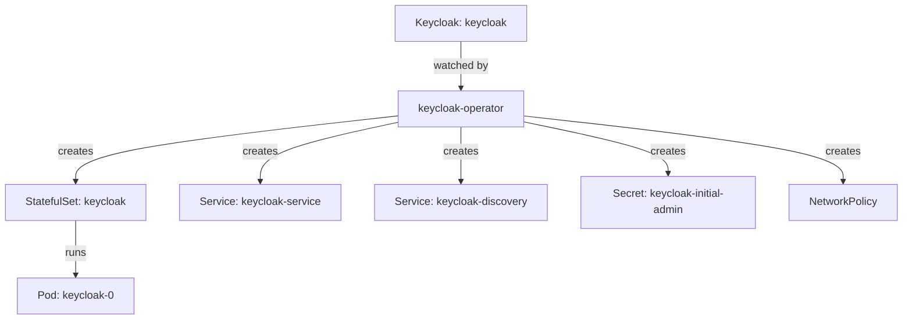

# What The Keycloak Operator Manages

Before you write a `Keycloak` resource, you need to know what happens after you apply it. Which program reads it, which objects appear, and which of them you may change? This part installs nothing new. It walks through the operator that already runs in your playground and every object it created for one `Keycloak` resource.

## The operator and its custom resources

The Keycloak Operator is a Deployment called `keycloak-operator`. It is a controller: a program that watches some kinds of objects in the Kubernetes API and keeps changing the cluster until the cluster matches them. The kinds it watches come from custom resource definitions (CRDs), schemas that add new resource kinds to the API.

The playground installed the operator from the plain manifests of the Keycloak project, version 26.8.1. This is the same install you would run on your own cluster:

```sh
BASE=https://raw.githubusercontent.com/keycloak/keycloak-k8s-resources/26.8.1/kubernetes
kubectl apply -f $BASE/keycloaks.k8s.keycloak.org-v1.yml
kubectl apply -f $BASE/keycloakrealmimports.k8s.keycloak.org-v1.yml
kubectl -n keycloak apply -f $BASE/kubernetes.yml
```

The first two files are CRDs. The third holds the operator's Deployment, its ServiceAccount and the roles that let it manage objects. The Keycloak documentation also shows a one-line form, `kubectl apply -k 'github.com/keycloak/keycloak-k8s-resources/kubernetes?ref=26.8.1'`, which installs the same set through Kustomize and needs `git` on your machine. The full set for 26.8.1 also has CRDs for `KeycloakOIDCClient` and `KeycloakSAMLClient`; this course does not use them.

Look at what is running. List the operator and the CRDs it brought:

<!-- astrona:playground:renew -->

```sh
kubectl -n keycloak get deployment keycloak-operator
kubectl get crd | grep k8s.keycloak.org
```

The operator Deployment shows one ready replica. The CRD list names `keycloaks.k8s.keycloak.org` and `keycloakrealmimports.k8s.keycloak.org`. Every resource of these kinds uses the API version `k8s.keycloak.org/v2beta1`.

One fact about the operator decides where everything in this course lives: **the operator watches only the namespace it is installed in.** A `Keycloak` resource in any other namespace is ignored, with no error. That is why the playground puts the operator, the database, the `Keycloak` resource and the `tester` pod all in the namespace `keycloak`. The Keycloak project also ships a cluster-wide variant of the install, which watches every namespace; this course uses the default.

## From one resource to many objects

Now look at the resource the operator works from. The playground has one `Keycloak` resource called `keycloak`:

```sh
kubectl -n keycloak get keycloak
kubectl -n keycloak get keycloak keycloak -o yaml | head -40
```

The `spec` is short: one instance, a PostgreSQL database, HTTP switched on, a hostname, no ingress, and memory limits. Everything else in the namespace that belongs to Keycloak was created by the operator from these few lines. The diagram shows what the operator creates for one `Keycloak` resource:



The diagram shows the operator turning one resource into a StatefulSet, two Services, a Secret and a network policy, and the StatefulSet running the pod.

List those objects in your playground:

```sh
kubectl -n keycloak get statefulset,service,secret,networkpolicy
```

The names follow fixed rules that the operator applies to every `Keycloak` resource:

| Object | Name | What it is for |
| --- | --- | --- |
| StatefulSet | `keycloak` (the resource name) | Runs the Keycloak pods `keycloak-0`, `keycloak-1` and so on |
| Service | `keycloak-service` (name plus `-service`) | The address clients use, here on port `8080` |
| Service | `keycloak-discovery` | A headless Service the instances use to find each other |
| Secret | `keycloak-initial-admin` | User name and password of a temporary administrator in `master` |
| NetworkPolicy | named after the resource | Keeps the clustering ports closed to everything except the Keycloak pods |
| Ingress | none here | The operator creates one by default; this playground sets `ingress.enabled: false`, because `kind` has no ingress controller |

The headless Service name and the network policy name may differ slightly from this table in your output; read the names from the command above. The rule that matters is the next one.

## Never edit what the operator owns

The operator keeps reconciling: when an object it owns differs from what the `Keycloak` resource describes, it changes the object back. So an edit to the StatefulSet lasts only until the next reconciliation. Try it. Scale the StatefulSet to two replicas by hand, wait a little, and look again:

```sh
kubectl -n keycloak scale statefulset keycloak --replicas=2
sleep 20
kubectl -n keycloak get statefulset keycloak
```

The StatefulSet is back at one replica, because the `Keycloak` resource still says `instances: 1`. The operator undid your change. If a second pod started for a moment, it was removed again. The same happens to Services and to the network policy.

The rule follows from this: **every change goes into the `Keycloak` resource.** If you need more instances, you change `spec.instances`. If you need an extra server option, you add it to `spec.additionalOptions`. The operator then rolls the change out to the objects it owns.

The operator also tells you how it is doing, in the operator's own log. When a `Keycloak` resource does not behave, the operator log is one of the three places to look, next to the resource's status and the Keycloak pod's log:

```sh
kubectl -n keycloak logs deployment/keycloak-operator --tail=20
```

You now know what the operator is, which namespace it watches, and which objects it creates for one `Keycloak` resource. You also know that those objects belong to the operator, and that every change goes through the resource. The open question is what goes into the resource itself, and how the operator reports back when it cannot do what the resource asks.

## Common pitfalls

> [!WARNING]
> - **Putting a `Keycloak` resource in another namespace.** The default install watches only its own namespace. The resource is accepted by the API server and then ignored, with no error anywhere.
> - **Editing the StatefulSet or the Services.** The operator changes them back on its next reconciliation. Change the `Keycloak` resource instead.
> - **Deleting the CRDs to "reinstall" the operator.** Deleting a CRD deletes every resource of that kind, and with them the Keycloak deployment.
> - **Forgetting `ingress.enabled: false` on a cluster with no ingress controller.** The operator creates an Ingress by default. It does no harm on `kind`, but it suggests a public address that does not exist.
