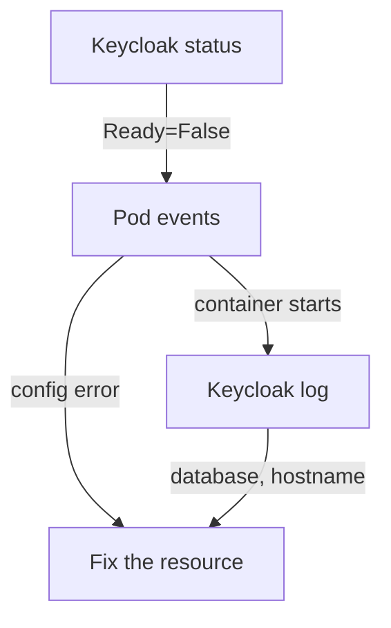

# The Keycloak Custom Resource

The `Keycloak` resource is the only place where you describe your server, so every mistake in a deployment starts there. Some mistakes the API server refuses at once. Many it accepts, because the resource is valid, and the result is a pod that never becomes ready. This part goes through the fields every deployment needs, shows how the operator reports what went wrong, and ends with signing in through the administrator the operator created.

## The fields every deployment needs

Read the resource that runs in your playground. It is short, and each block answers one question the operator must know before it can start Keycloak:

<!-- astrona:playground:renew -->

```sh
kubectl -n keycloak get keycloak keycloak -o yaml
```

The `spec` holds these blocks. The same YAML is the starting point for every `Keycloak` resource in this course:

```yaml
apiVersion: k8s.keycloak.org/v2beta1
kind: Keycloak
metadata:
  name: keycloak
  namespace: keycloak
spec:
  instances: 1
  db:
    vendor: postgres
    host: postgres
    database: keycloak
    usernameSecret:
      name: keycloak-db
      key: username
    passwordSecret:
      name: keycloak-db
      key: password
  http:
    httpEnabled: true
  hostname:
    hostname: http://keycloak-service:8080
  ingress:
    enabled: false
  additionalOptions:
    - name: health-enabled
      value: "true"
    - name: metrics-enabled
      value: "true"
  resources:
    requests:
      memory: 768Mi
      cpu: 250m
    limits:
      memory: 1536Mi
```

Each block does one job:

| Field | What it does |
| --- | --- |
| `instances` | The number of Keycloak pods. The operator sets the StatefulSet's replicas from it |
| `db` | The database. `vendor` and `host` (plus `database`, `port` or a full `url`) build the JDBC address; `usernameSecret` and `passwordSecret` point at keys in a Kubernetes Secret, so no credential is written in the resource |
| `http.httpEnabled` | Opens the HTTP listener on port `8080`. Without it, Keycloak needs a TLS certificate in `http.tlsSecret` |
| `hostname.hostname` | The public address of the server. Keycloak runs in production mode, which refuses to start without a hostname |
| `ingress.enabled` | Whether the operator creates an Ingress. The default is `true` |
| `additionalOptions` | Any other server option, by its `kc.sh` name, as a `name` and a `value` or a `secret` reference. Numbers and booleans are quoted |
| `resources` | Memory and CPU for each pod. Without it, the operator asks for 1700MiB of memory per pod and sets a 2GiB limit |

The `kubectl explain` command prints the documentation of any field straight from the CRD. Use it whenever you are not sure of a field's name or type:

```sh
kubectl explain keycloak.spec.db
kubectl explain keycloak.spec.hostname
```

The output lists each field with its type and a one-line description. It is the 26.8.1 schema itself, so it is always right for the operator you run. For anything the resource has no field for, there is `spec.unsupported.podTemplate`, a raw pod template that the operator merges into the StatefulSet. As its name says, the Keycloak project does not support it; use it only as a short-term workaround.

## Reading the status conditions

The operator reports back in `.status.conditions`. A condition is one line with a type, a status and a message. A `Keycloak` resource has three that matter: `Ready` (all instances are running and ready), `HasErrors` (the operator found a problem, explained in the message) and `RecreateUpdateUsed` (how the last update was rolled out). Print them as plain lines:

```sh
kubectl -n keycloak get keycloak keycloak \
  -o go-template='{{range .status.conditions}}{{.type}}={{.status}} {{.message}}{{"\n"}}{{end}}'
```

In your playground, `Ready` is `True` and `HasErrors` is `False`. Now break the resource on purpose to see the other side. The patch below points the database password at a key that does not exist in the Secret:

```sh
kubectl -n keycloak patch keycloak keycloak --type merge \
  -p '{"spec":{"db":{"passwordSecret":{"name":"keycloak-db","key":"pass"}}}}'
```

The operator accepts the change and rolls it out. The new pod cannot start, because Kubernetes cannot find the key `pass` in the Secret `keycloak-db`. Watch the three places where the failure shows up:

```sh
kubectl -n keycloak get keycloak keycloak \
  -o go-template='{{range .status.conditions}}{{.type}}={{.status}} {{.message}}{{"\n"}}{{end}}'
kubectl -n keycloak get pods
kubectl -n keycloak describe pod keycloak-0 | tail -15
```

The `Ready` condition turns `False`, and its message says that not all instances are ready. The pod shows the status `CreateContainerConfigError`, and the events at the end of `describe` name the missing key. This is the usual path: **the condition tells you that something is wrong, and the pod events or the pod log tell you what.** A wrong host name would get further: the container would start, and the Keycloak log would show that it cannot connect to the database.



The diagram shows the order of the investigation: the condition first, then the pod events, then the Keycloak log, and every fix goes back into the resource.

Put the key back so your playground works again:

```sh
kubectl -n keycloak patch keycloak keycloak --type merge \
  -p '{"spec":{"db":{"passwordSecret":{"name":"keycloak-db","key":"password"}}}}'
```

After a minute or two, `Ready` is `True` again. If it is not, run the condition command again; the operator replaces the pod, and the new pod needs time to start.

## The initial admin Secret

The operator creates a temporary administrator in the `master` realm when the server starts the first time, and it stores the credentials in the Secret `keycloak-initial-admin`. Read the user name and the password from it, then sign in with `kcadm.sh`, the administration tool inside the Keycloak image:

```sh
ADMIN_USER=$(kubectl -n keycloak get secret keycloak-initial-admin -o jsonpath='{.data.username}' | base64 -d)
ADMIN_PASSWORD=$(kubectl -n keycloak get secret keycloak-initial-admin -o jsonpath='{.data.password}' | base64 -d)
kcadm() {
  kubectl -n keycloak exec -i keycloak-0 -- \
    /opt/keycloak/bin/kcadm.sh "$@" --config /tmp/kcadm.config
}
kcadm config credentials --server http://localhost:8080 --realm master --user "$ADMIN_USER" --password "$ADMIN_PASSWORD"
kcadm get realms --fields realm,enabled
```

The last command lists the realms `master` and `inventory`. The password is random for each cluster, which is why you always read it from the Secret. This administrator is meant to be temporary: on a real system you create a permanent administrator, or connect your own identity provider, and then delete this one. Keep the Secret private either way, because anyone who can read Secrets in the namespace can sign in as that administrator.

You now know the fields a `Keycloak` resource needs, how the operator reports a failure in its conditions, and where to look next when a condition says `False`. You can also sign in through the administrator the operator created. The next question is how to create realms without the console.

## Common pitfalls

> [!WARNING]
> - **Typing the database password into `additionalOptions`.** It works, and it puts the password in plain text in a resource many people can read. Use `db.passwordSecret`.
> - **Stopping at the condition.** `Ready=False` says only that something is wrong. The pod events and the Keycloak log say what.
> - **Leaving out `hostname`.** Keycloak in production mode refuses to start without it, and the operator always runs production mode.
> - **Waiting for a broken pod to fix itself.** After you correct the `Keycloak` resource, the operator updates the StatefulSet, but the StatefulSet does not replace a pod that never became ready. Delete the stuck pod (`kubectl -n keycloak delete pod keycloak-0`) so it is created again from the fixed template.
> - **Leaving out `resources` on a small cluster.** The default request of 1700MiB per pod leaves a second pod stuck in `Pending`.

## Your mission: Fix A Keycloak Resource That Never Becomes Ready

You can now read a `Keycloak` resource, follow a failure from its conditions to the pod, and fix it in the resource. The graded lab gives you a `Keycloak` resource that has never become ready, with two separate faults in its database settings, and asks you to fix both without writing the password into the resource.

The lab runs in its own cluster, so first pause your playground. Nothing in it is lost:

```sh
astrona stop ats-093-playground-010-01
```

Then start the lab:

```sh
astrona run --git ssh://git@github.com/astrona-io/ATS093.git -c sections/section-010/module-01/labs/lab-01
```

The task is on the next page. Solve it on your own first. When you think you are done, send it for grading:

```sh
astrona submit -c sections/section-010/module-01/labs/lab-01
```

When the lab is done, remove it and start your playground again:

```sh
astrona destroy ats-093-lab-010-01
astrona start ats-093-playground-010-01
```
