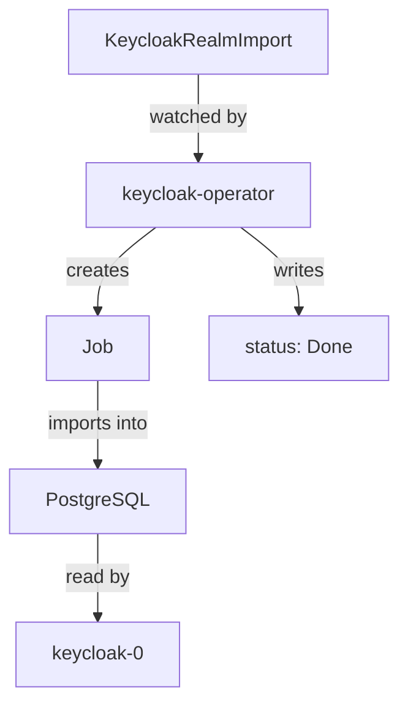

# Importing Realms With KeycloakRealmImport

A new Keycloak has only the `master` realm. Clicking the application realm together in the console works once, but it cannot be repeated on the next cluster, and it leaves no record of what was done. The operator offers a second custom resource for this, `KeycloakRealmImport`. This part creates a realm with it, keeps the user's password out of the resource, and shows the one rule that surprises everyone: an import never changes a realm that already exists.

## How a realm import works

A `KeycloakRealmImport` names a `Keycloak` resource and holds a full realm description in `spec.realm`. That description is the same JSON a realm export produces, written as YAML: the realm's settings, its users, its clients and its roles. When you apply the resource, the operator starts a Kubernetes Job. The Job runs the Keycloak image once against the same database, imports the realm, and stops.



The diagram shows the import path: the operator turns the resource into a Job, the Job writes the realm into the database, and the running Keycloak reads it from there.

Your playground already has one import, `inventory`, which created the realm of the same name. Look at it and at its status:

<!-- astrona:playground:renew -->

```sh
kubectl -n keycloak get keycloakrealmimport
kubectl -n keycloak get keycloakrealmimport inventory \
  -o go-template='{{range .status.conditions}}{{.type}}={{.status}} {{.message}}{{"\n"}}{{end}}'
```

A finished import shows three conditions: `Done` is `True`, `Started` is `False` and `HasErrors` is `False`. `Started` goes back to `False` because the Job is no longer running.

## Keep passwords in a Secret with placeholders

A realm description often holds secrets: a user's first password, a client secret, an identity provider's key. Writing them into the resource puts them in Git and in every backup of the cluster. Placeholders avoid that. `spec.placeholders` maps a name to a key in a Kubernetes Secret, and the realm uses the name as `${NAME}`. The Job receives the value as an environment variable and replaces the placeholder while it imports.

Create a second realm, `warehouse`, the same way. Its user takes the password from the existing Secret `inventory-secrets`, key `alice-password`.

Save this as `keycloakrealmimport-warehouse.yaml`:

```yaml
apiVersion: k8s.keycloak.org/v2beta1
kind: KeycloakRealmImport
metadata:
  name: warehouse
  namespace: keycloak
spec:
  keycloakCRName: keycloak
  placeholders:
    ALICE_PASSWORD:
      secret:
        name: inventory-secrets
        key: alice-password
  realm:
    realm: warehouse
    enabled: true
    users:
      - username: alice
        enabled: true
        email: alice@example.com
        emailVerified: true
        firstName: Alice
        lastName: Example
        credentials:
          - type: password
            value: ${ALICE_PASSWORD}
            temporary: false
    clients:
      - clientId: warehouse-cli
        enabled: true
        publicClient: true
        standardFlowEnabled: false
        directAccessGrantsEnabled: true
```

Apply it:

```sh
kubectl apply -f keycloakrealmimport-warehouse.yaml
```

Then check the result. Watch the Job appear and finish, then read the conditions:

```sh
kubectl -n keycloak get jobs
kubectl -n keycloak get keycloakrealmimport warehouse \
  -o go-template='{{range .status.conditions}}{{.type}}={{.status}} {{.message}}{{"\n"}}{{end}}'
```

When `Done` is `True`, request a token for `alice` in the new realm from the `tester` pod. The request uses the password grant, where the client sends the user's password; OAuth 2.1 drops this grant, and a real application signs users in through the browser instead. Here it only proves that the password from the Secret arrived:

```sh
kubectl -n keycloak exec deploy/tester -- \
  curl -s http://keycloak-service:8080/realms/warehouse/protocol/openid-connect/token \
    -d grant_type=password -d client_id=warehouse-cli \
    -d username=alice -d password=alice-password | jq -r '.access_token | split(".")[1]' | head -c 40; echo
```

The command prints the start of the token's payload, so the request succeeded. The resource itself holds only the text `${ALICE_PASSWORD}`; the password lives in the Secret.

## An import never updates a realm

Now change the import and apply it again. Add a second client, `warehouse-reports`, to the `clients` list in `keycloakrealmimport-warehouse.yaml`:

```yaml
      - clientId: warehouse-reports
        enabled: true
        publicClient: true
        standardFlowEnabled: false
        directAccessGrantsEnabled: true
```

Apply it:

```sh
kubectl apply -f keycloakrealmimport-warehouse.yaml
```

Then check whether the client exists. Sign in with the initial admin Secret first, the same way as for any `kcadm.sh` work:

```sh
ADMIN_USER=$(kubectl -n keycloak get secret keycloak-initial-admin -o jsonpath='{.data.username}' | base64 -d)
ADMIN_PASSWORD=$(kubectl -n keycloak get secret keycloak-initial-admin -o jsonpath='{.data.password}' | base64 -d)
kcadm() {
  kubectl -n keycloak exec -i keycloak-0 -- \
    /opt/keycloak/bin/kcadm.sh "$@" --config /tmp/kcadm.config
}
kcadm config credentials --server http://localhost:8080 --realm master --user "$ADMIN_USER" --password "$ADMIN_PASSWORD"
kcadm get clients -r warehouse --fields clientId
```

The list has `warehouse-cli` and the built-in clients, but not `warehouse-reports`. This is the rule: **a `KeycloakRealmImport` only creates a realm that does not exist yet.** If the realm exists, the import leaves it alone. It never updates a realm, never deletes one, and changes made in the console are never written back to the resource.

So a realm import is a way to create a realm on a new cluster, not a way to manage it. Day-to-day changes to an existing realm go through the console, `kcadm.sh` or the Admin REST API. Deleting the `KeycloakRealmImport` resource only cleans up its Job; the realm stays. One more point follows from how placeholders work: the Job can read every environment variable the server has, so only people who may administer the whole namespace should be allowed to create realm imports.

You now know how to create a realm with the operator, how to keep its secrets in a Kubernetes Secret, and why an import cannot be used to change a realm later. Together with the `Keycloak` resource, that is everything needed to bring up a new Keycloak with its application realm from files alone.

## Common pitfalls

> [!WARNING]
> - **Expecting a changed import to change the realm.** An import only creates. Change an existing realm with `kcadm.sh` or the console.
> - **Writing passwords and client secrets into `spec.realm`.** Use `spec.placeholders` and a Secret in the same namespace.
> - **Creating the import before the `Keycloak` resource exists.** The import names the resource in `keycloakCRName`; with no such resource, the import waits or reports an error.
> - **Leaving out a user's email, first name or last name.** The default user profile requires them, and a user without them cannot finish a sign-in until the profile is complete.
