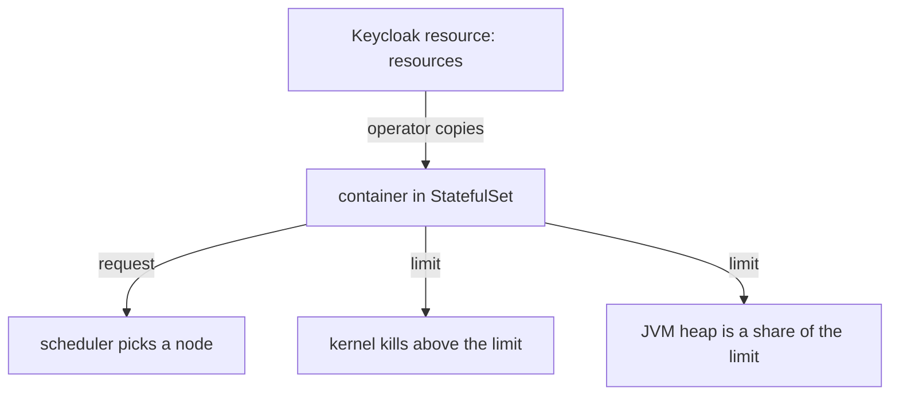

# Resources And Java Memory

A Keycloak pod that has too little memory is killed, and a pod that asks for too much memory never starts. Both failures look like a broken Keycloak, but the cause is a number in the `Keycloak` resource. This part explains what `resources` does, how the Java Virtual Machine (JVM, the program that runs Keycloak) uses the memory limit, and how to see the result on the pod.

## Requests and limits

Kubernetes uses two numbers for each resource. The **request** is what the scheduler reserves on a node: a pod is placed only on a node that has the full request free. The **limit** is the most the container may use: for memory, the kernel kills a container that goes over it.

In the `Keycloak` resource both live under `spec.resources`, and the operator copies the block into the container of the StatefulSet. Read the block in your playground, then read the same values on the pod:

<!-- astrona:playground:renew -->

```sh
kubectl -n keycloak get keycloak keycloak -o jsonpath='{.spec.resources}{"\n"}'
kubectl -n keycloak get pod keycloak-0 -o jsonpath='{.spec.containers[0].resources}{"\n"}'
```

The two lines carry the same numbers: a request of `768Mi` of memory and `250m` of CPU (a quarter of one core), and a memory limit of `1536Mi`. A `Keycloak` resource without `resources` gets the operator's defaults. The default memory request is 1700MiB, which is more than a small node can give to a second pod.

## How the JVM uses the memory limit

Keycloak runs on the JVM. The JVM keeps its objects in the heap, and the Keycloak container image sets the heap size as a percentage of the container memory limit. By default the maximum heap is about 70 percent of the limit. The rest of the limit is for memory outside the heap: thread stacks, caches inside the JVM and native libraries.

This has two results. First, the memory limit is the setting that decides the heap size, so a container with no memory limit can use the memory of the whole node. Second, a heap that is too large for the limit does not fit, and the kernel ends the container with the reason `OOMKilled`. Setting the request equal to the limit gives the pod a guaranteed amount of memory; setting the limit above the request lets the pod use spare memory on the node, at the risk of being killed first when the node runs short.

## See why a pod does not run

Two events are common. A pod that is `Pending` has not been placed on a node, and the scheduler says why in the pod events. A container that was killed shows its last state in the pod status:

```sh
kubectl -n keycloak describe pod keycloak-0 | grep -A8 -i "last state\|events"
```

For a `Pending` pod the event reads that no node has enough memory or CPU. For a killed container the last state shows `OOMKilled` with exit code `137`. The first problem is solved by a smaller request, or by a larger node. The second is solved by a larger memory limit.



The diagram shows that one block of the resource reaches three places: the scheduler, the kernel and the JVM.

You now know where the numbers come from and how to read them on the pod. The next question is which node the pod runs on, and what to do when Kubernetes has more than one to choose from.

## Common pitfalls

> [!WARNING]
> - **Leaving out the memory limit.** The heap is sized from the limit, so without one the JVM sizes itself from the node memory and can take far more than you planned.
> - **Setting a request larger than any node.** The pod stays `Pending` and the operator has nothing wrong to report. The event on the pod has the reason.
> - **Reading `OOMKilled` as a Keycloak bug.** It means the container went over its memory limit. Raise the limit, or find out what uses the memory.
> - **Setting the limit to the node size.** The JVM uses a share of the limit for the heap, and the pod still needs room for memory outside the heap.
