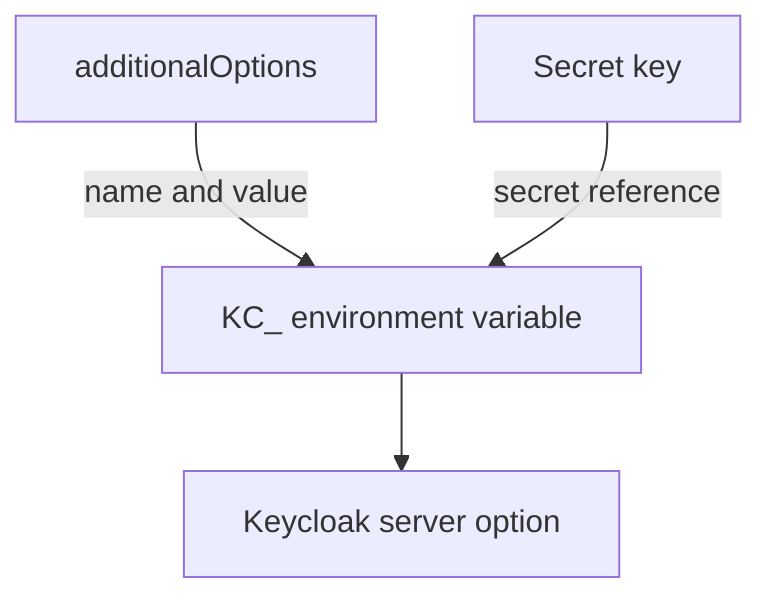

# Server Options And Secrets

Keycloak has hundreds of server options: the log format, the cache stack, the health endpoints, the HTTP settings. The `Keycloak` resource has typed fields for the options the operator itself needs, and one open field, `additionalOptions`, for all the others. This part shows how an option reaches the server, how a value comes from a Kubernetes Secret, and how to set the log format as an example.

## From additionalOptions to the container

Every Keycloak option has a name such as `log-console-output`. On the command line it is `--log-console-output=json`, and in the container it is the environment variable `KC_LOG_CONSOLE_OUTPUT`. In `additionalOptions` you write the command-line name without the leading dashes, and the operator sets the matching environment variable on the container.

```yaml
additionalOptions:
  - name: log-console-output
    value: json
```

Read the list in your playground, and then the environment variable the operator made:

<!-- astrona:playground:renew -->

```sh
kubectl -n keycloak get keycloak keycloak -o jsonpath='{.spec.additionalOptions}{"\n"}'
kubectl -n keycloak get pod keycloak-0 \
  -o jsonpath='{range .spec.containers[0].env[*]}{.name}={.value}{"\n"}{end}' | grep KC_LOG
```

The second command prints `KC_LOG_CONSOLE_OUTPUT=json` and `KC_LOG_LEVEL=INFO`. A `Keycloak` resource has typed fields for some options, for example `http`, `hostname` and `db`. Use the typed field for those options and do not set the same option a second time in `additionalOptions`, because the two values then compete.

## A value from a Secret

A password or a key must not sit in the resource, because anyone who can read the resource can read the value. An entry in `additionalOptions` can take `secret` instead of `value`. The operator then adds an environment variable on the container that reads the value from the Secret key at start time:

```yaml
additionalOptions:
  - name: spi-email-sender-password
    secret:
      name: smtp-credentials
      key: password
```

The Secret must exist in the namespace of the `Keycloak` resource, and the key must exist in it. A missing Secret or key keeps the container from being created, with the status `CreateContainerConfigError`, as for the database credentials. The pod event names the missing key.

## Read the log in JSON

With `log-console-output: json`, Keycloak writes each log record as one JSON object on one line, which log collectors parse without extra rules. Check the last line of the log:

```sh
kubectl -n keycloak logs keycloak-0 --tail=1
```

The line is a JSON object with fields such as the timestamp, the level, the logger name and the message. The level comes from `log-level`; it can also name a category, as in `INFO,org.keycloak.events:debug`, which keeps the root level at `INFO` and raises one category.



The diagram shows both sources of a value ending in the same environment variable, which Keycloak reads as its option.

You can now set any option and keep the secret ones out of the resource. One more thing in the module is still hands-on: changing the resources, the spread rule and the log format of a resource that does not start.

## Common pitfalls

> [!WARNING]
> - **Putting a password in `value`.** Use `secret` so that the value stays in a Secret.
> - **Setting an option twice.** An option with a typed field in the resource belongs in that field, not also in `additionalOptions`.
> - **Writing `--log-level` or `KC_LOG_LEVEL` as the name.** Use the name without dashes and without the prefix: `log-level`.
> - **Expecting an option change to apply without a restart.** A change in `additionalOptions` changes the pod template, so the operator replaces the pod.

## Your mission: Set Resources, Scheduling And Log Format

You can now read the pod template the operator builds and change the resources, the scheduling rules and the options in the resource. The graded lab gives you a `Keycloak` resource whose memory request no node can give, so the pod stays `Pending`, and asks you to fix the resources, add a spread constraint and switch the console log to JSON.

The lab runs in its own cluster, so first pause your playground. Nothing in it is lost:

```sh
astrona stop ats-093-playground-010-02
```

Then start the lab:

```sh
astrona run --git ssh://git@github.com/astrona-io/ATS093.git -c sections/section-010/module-02/labs/lab-01
```

The task is on the next page. Solve it on your own first. When you think you are done, send it for grading:

```sh
astrona submit -c sections/section-010/module-02/labs/lab-01
```

When the lab is done, remove it and start your playground again:

```sh
astrona destroy ats-093-lab-010-02-01
astrona start ats-093-playground-010-02
```
