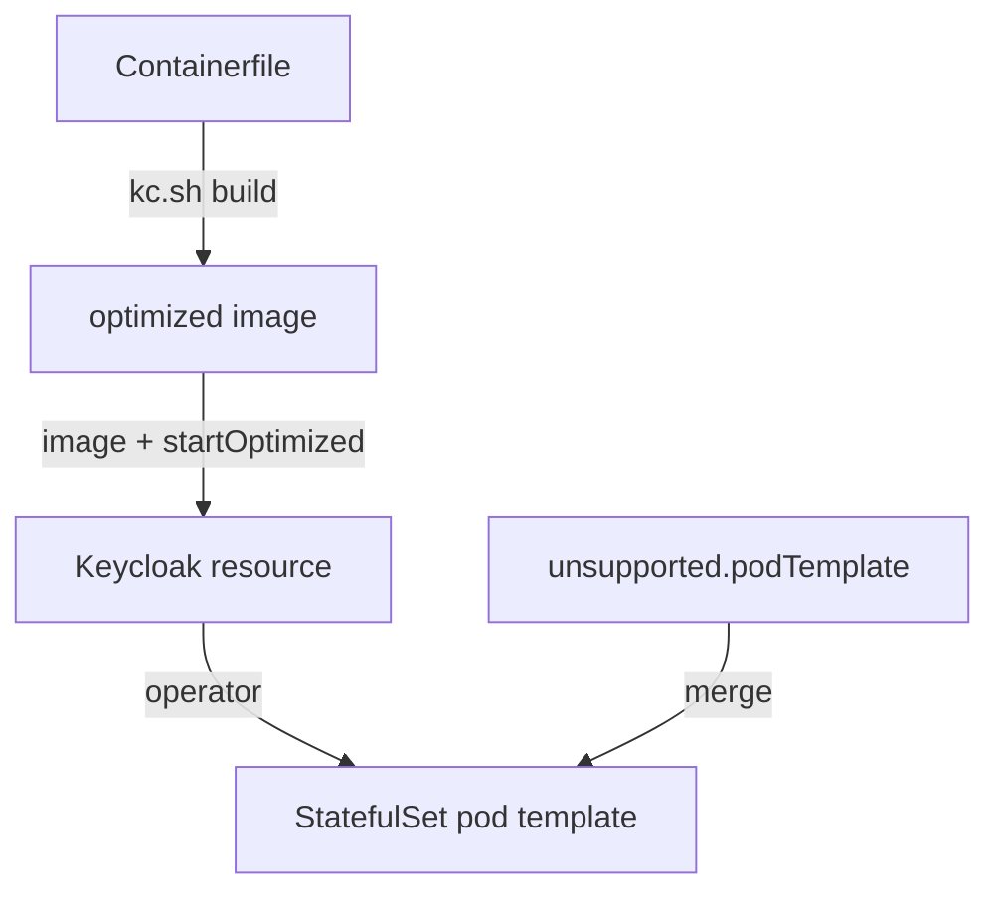

# Pod Template And Custom Images

The typed fields of the `Keycloak` resource cover the common cases. Sometimes a deployment needs more: a provider that adds a custom authenticator, a theme, an extra volume or a different grace period for shutdown. This part shows the two ways out of the typed fields: a custom image, which is supported, and `unsupported.podTemplate`, which is not.

## Run your own image

The `image` field of the `Keycloak` resource names the container image for the pods. Without it, the operator uses the Keycloak image that matches its own version. A custom image starts from the official image and adds files: provider JAR files in `/opt/keycloak/providers`, themes in `/opt/keycloak/themes`, and a build step that runs `kc.sh build`.

The build step matters. Keycloak does some work once, at build time, such as choosing the database vendor and registering providers. A container that starts without a prior build does this work on every start, which makes each start slower. An optimized image does it once while the image is built:

```dockerfile
FROM quay.io/keycloak/keycloak:26.8.1 AS builder
ENV KC_DB=postgres
COPY my-authenticator.jar /opt/keycloak/providers/
RUN /opt/keycloak/bin/kc.sh build

FROM quay.io/keycloak/keycloak:26.8.1
COPY --from=builder /opt/keycloak/ /opt/keycloak/
```

The first stage builds with the database vendor and the provider. The second stage starts again from the clean official image and copies the finished `/opt/keycloak` directory into it. The name `my-authenticator.jar` is only an example of a provider file.

## Tell the operator the image is optimized

With an optimized image, the operator must start Keycloak with `--optimized`, so Keycloak skips the build check. Set `startOptimized: true`:

```yaml
spec:
  image: registry.example.com/keycloak-custom:26.8.1-1
  startOptimized: true
```

If `image` is set and `startOptimized` is not, the operator starts Keycloak in the normal way, and Keycloak runs the build step again at each start. A build option that differs between the image and the resource, such as the database vendor, is a mistake: the build-time value wins on an optimized image, so a change needs a new image. If the registry needs credentials, name the pull Secret in `imagePullSecrets`.

Change the image tag for every new build. A tag that is reused, such as `latest`, can leave nodes with an older copy.

## The unsupported pod template

`spec.unsupported.podTemplate` takes a partial pod template. The operator merges it into the one it generates, and it is the only way to change a field that has no typed field in the resource: extra volumes and mounts, init containers, a different `terminationGracePeriodSeconds`, extra labels or annotations.

```yaml
spec:
  unsupported:
    podTemplate:
      spec:
        terminationGracePeriodSeconds: 90
```

The name `unsupported` is a warning. The Keycloak project does not support deployments that depend on a merged template, because a later operator version can change the generated template, and the merge can then break or change in meaning. Prefer the typed fields and a custom image, and keep what is in `podTemplate` as small as possible. Print the pod template the operator produced to see the merged result:

<!-- astrona:playground:renew -->

```sh
kubectl -n keycloak get statefulset keycloak \
  -o jsonpath='{.spec.template.spec.terminationGracePeriodSeconds}{"\n"}'
```

An unset value prints the Kubernetes default of `30`. After you add the template above in the playground, the pod template shows `90`.



The diagram shows two inputs reaching the pod template: the supported path through the image, and the unsupported merge.

You can now choose between a typed field, an image and a merged template. The module ends here: every part of the pod is now set in one place, the `Keycloak` resource.

## Common pitfalls

> [!WARNING]
> - **Setting `image` and forgetting `startOptimized`.** The server then runs the build step again on every start.
> - **Setting `startOptimized` with an image that was not built.** Keycloak refuses to start, because the optimized start needs a build that already exists.
> - **Reusing an image tag.** Nodes can keep the old copy. Use a new tag per build.
> - **Putting everything in `unsupported.podTemplate`.** A change that fits a typed field or the image belongs there, because the template is outside of project support.
