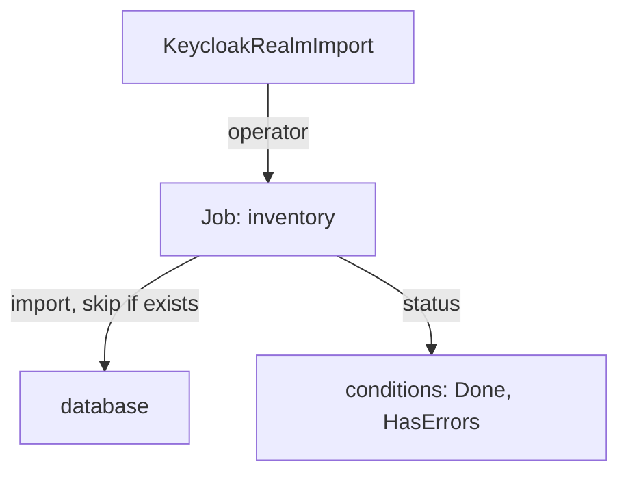

# How A Realm Import Works

A `KeycloakRealmImport` looks like a description of a realm, and it is tempting to treat it that way: change the file, apply it, and expect the realm to follow. It does not follow. This part shows what the operator does with the resource, where the work happens, and what the status tells you.

## From the resource to a Job

The `spec.realm` field of a `KeycloakRealmImport` holds a realm in the same JSON structure that Keycloak exports, written as YAML. The `spec.keycloakCRName` field names the `Keycloak` resource that should receive it. When the resource is created, the operator creates a Kubernetes Job. A Job is a pod that runs once and then stops. The Job starts a Keycloak container with the option `import` and the realm file mounted from a Secret, and that container writes the realm into the database.

Look at the objects the operator made in the playground:

<!-- astrona:playground:renew -->

```sh
kubectl -n keycloak get keycloakrealmimport,job,pods
kubectl -n keycloak get keycloakrealmimport inventory \
  -o go-template='{{range .status.conditions}}{{.type}}={{.status}} {{.message}}{{"\n"}}{{end}}'
```

The import appears with the condition `Done=True`, and the Job has the status `Complete`. Two other conditions can appear. `Started` is `True` while the Job runs. `HasErrors` is `True` when the Job failed, and its message says why in one line.

## What the import never does

The container imports with the strategy that skips a realm that already exists. If the realm `inventory` is in the database, the Job finds it, leaves it alone and ends successfully. This is why the operator can safely rerun the Job after a restart, and it is also why editing the resource later has no effect on the realm.

The same rule means the import does not delete anything. Removing the `KeycloakRealmImport` resource removes the Job, and the realm stays in Keycloak. To see this, compare the realm before and after you edit the first name of `alice` in the resource and apply it again:

```sh
kubectl -n keycloak exec deploy/tester -- curl -s \
  http://keycloak-service:8080/realms/inventory/.well-known/openid-configuration | jq -r .issuer
```

The realm still answers with the same issuer, whatever the resource says. A change to a realm that exists goes through the Admin REST API, which the next part uses.

## When the import fails

A Job that fails leaves a pod with a log. The most common reasons are a placeholder whose Secret does not exist, a realm field that Keycloak rejects, and a `keycloakCRName` that names a `Keycloak` resource that is not ready. Read the condition message first, then the Job pod log:

```sh
kubectl -n keycloak logs job/inventory --tail=20
```

The log of a finished import ends with a line that says the import is done. A failed one ends with the exception.



The diagram shows that the resource only starts a Job: the realm lives in the database, not in the resource.

You now know what an import does once and what it leaves alone. The next question is how to change a realm after it exists.

## Common pitfalls

> [!WARNING]
> - **Editing the import and expecting the realm to change.** The import skips a realm that exists.
> - **Deleting the `KeycloakRealmImport` to remove the realm.** The resource and the realm are separate; the realm stays.
> - **Naming a `Keycloak` resource that is not ready.** The Job cannot reach the server, and the status shows `HasErrors`.
> - **Ignoring the Job log.** The condition message is one line; the log has the cause.
