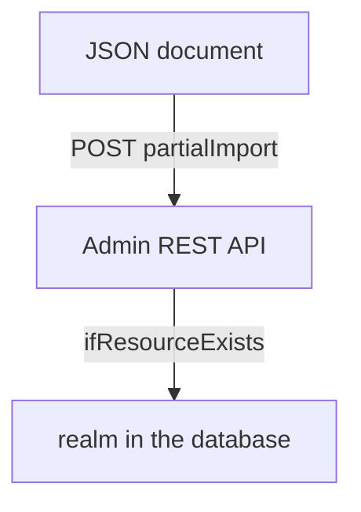

# Changing A Realm That Exists

Once a realm exists, every change goes through the Keycloak Admin REST API. That includes realm settings, new clients and new users. This part uses `kcadm.sh`, the command-line client of the API, and the partial import endpoint, which accepts a bundle of clients, users, groups and roles and says what to do with the ones that already exist.

## Sign kcadm.sh in

`kcadm.sh` is in every Keycloak container. It keeps its sign-in state in a config file, so give it a path and sign in once with the initial administrator from the Secret `keycloak-initial-admin`. Paste the helpers first:

<!-- astrona:playground:renew -->

```sh
kcadm() {
  kubectl -n keycloak exec -i keycloak-0 -- \
    /opt/keycloak/bin/kcadm.sh "$@" --config /tmp/kcadm.config
}
kcadm_login() {
  kcadm config credentials --server http://localhost:8080 --realm master \
    --user "$(kubectl -n keycloak get secret keycloak-initial-admin -o jsonpath='{.data.username}' | base64 -d)" \
    --password "$(kubectl -n keycloak get secret keycloak-initial-admin -o jsonpath='{.data.password}' | base64 -d)"
}
kcadm_login
```

The server address is `http://localhost:8080` because the command runs inside the Keycloak pod.

## Read, create and update

The verbs are `get`, `create`, `update` and `delete`, followed by a path of the Admin REST API. The option `-r` names the realm. Read a setting, create a client and change the realm:

```sh
kcadm get realms/inventory --fields realm,accessTokenLifespan
kcadm create clients -r inventory -s clientId=probe-web -s enabled=true -s publicClient=true
kcadm update realms/inventory -s accessTokenLifespan=600
kcadm get clients -r inventory -q clientId=probe-web --fields id,clientId,publicClient
```

Each `-s` sets one field, and a list or object is written as JSON, for example `-s 'redirectUris=["https://probe.example.com/*"]'`. The `update` verb changes only the fields you name. The identifier of a client is a UUID, not the client ID, so look it up with `-q clientId=...` before you update or delete the client.

## Partial import

The partial import endpoint takes a JSON document with the keys `clients`, `users`, `groups`, `roles` and `identityProviders`, and an `ifResourceExists` setting. The three values decide what happens to an entry that is already there:

| Value | What it does with an existing entry |
| --- | --- |
| `SKIP` | Leaves it unchanged and continues |
| `OVERWRITE` | Replaces it with the entry from the document |
| `FAIL` | Stops with an error |

Save this as `probe-clients.json`:

```json
{
  "ifResourceExists": "OVERWRITE",
  "clients": [
    {"clientId": "probe-web", "enabled": true, "publicClient": true,
     "redirectUris": ["https://probe.example.com/*"]}
  ]
}
```

Send it with `kcadm.sh`, which reads the body from standard input:

```sh
kubectl -n keycloak exec -i keycloak-0 -- /opt/keycloak/bin/kcadm.sh create partialImport \
  -r inventory -f - --config /tmp/kcadm.config < probe-clients.json
```

The answer lists how many entries were added, skipped or overwritten. Overwriting replaces the whole entry, so any field you leave out returns to its default. Use `OVERWRITE` for a client you fully describe, and `SKIP` to add only what is missing.



The diagram shows that the document goes through the same API as `kcadm create`, with a rule for entries that exist.

You can now change a live realm. Next, the operator has a resource for clients, which removes the need to call the API yourself.

## Common pitfalls

> [!WARNING]
> - **Updating a client by its client ID.** The API paths use the UUID. Look it up with `-q clientId=`.
> - **Using `OVERWRITE` with a short document.** The entry is replaced, so omitted fields go back to defaults.
> - **Forgetting `-r`.** Without it, the command works on the `master` realm.
> - **Typing a password with `-s`.** It stays in the shell history. Read it from a Secret instead.

## Your mission: Update A Realm That Was Already Imported

You can now tell an import from a change and use `kcadm.sh` against a live realm. The graded lab gives you a realm that a `KeycloakRealmImport` created, and asks you to add a client for a new web application and lengthen the access token lifespan, without touching the import.

The lab runs in its own cluster, so first pause your playground. Nothing in it is lost:

```sh
astrona stop ats-093-playground-010-03
```

Then start the lab:

```sh
astrona run --git ssh://git@github.com/astrona-io/ATS093.git -c sections/section-010/module-03/labs/lab-01
```

The task is on the next page. Solve it on your own first. When you think you are done, send it for grading:

```sh
astrona submit -c sections/section-010/module-03/labs/lab-01
```

When the lab is done, remove it and start your playground again:

```sh
astrona destroy ats-093-lab-010-03-01
astrona start ats-093-playground-010-03
```
