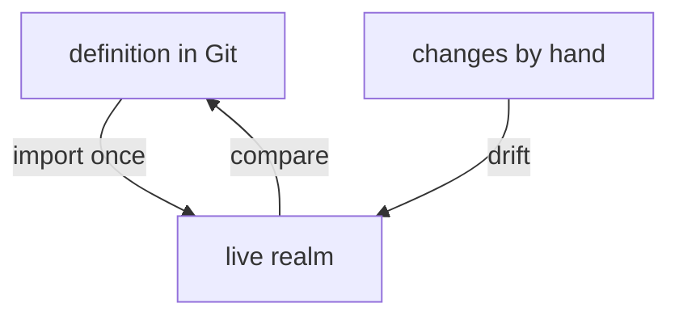

# Configuration Across Environments

A team that runs Keycloak has at least a test and a production environment. They must hold the same realms and clients, with different hostnames and different secrets. This part shows how placeholders keep one realm definition for all environments, and how to notice when a live realm has moved away from the definition.

## Placeholders

An import cannot contain a password if the file is in Git. The field `spec.placeholders` of the `KeycloakRealmImport` solves this. Each placeholder has a name and a source, and the import replaces `${NAME}` in the realm with the value:

<!-- astrona:playground:renew -->

```sh
kubectl -n keycloak get keycloakrealmimport inventory -o jsonpath='{.spec.placeholders}{"\n"}'
kubectl -n keycloak get secret inventory-secrets -o jsonpath='{.data}' | jq 'keys'
```

The placeholder `ALICE_PASSWORD` reads the key `alice-password` of the Secret `inventory-secrets`. The Secret differs per environment and the realm definition does not. The Job receives the values as environment variables, so a missing Secret fails the Job, and the failure shows in `HasErrors`.

## One definition, many environments

Keep the realm in one file and change only what differs: the Secret contents, the hostname in `redirectUris`, and the `Keycloak` resource name. Tools such as Kustomize or Helm do the substitution outside Keycloak. Placeholders cover only secret values; they are not a general template language.

A rule that avoids many mistakes: put into the import only what a new environment needs on day one. Everything people change later through the console, such as users and group memberships, belongs in the database and in the backup, not in Git.

## Drift

Drift is the difference between the definition in Git and the realm in the database. It grows whenever someone changes the realm by hand, because the import never corrects it. Find drift by exporting the live realm and comparing it with the definition:

```sh
kubectl -n keycloak exec keycloak-0 -- /opt/keycloak/bin/kcadm.sh get realms/inventory \
  --fields realm,accessTokenLifespan,bruteForceProtected --config /tmp/kcadm.config
```

The command prints a few settings from the live realm. Compare them with the realm in the `KeycloakRealmImport`. Where they differ, decide which side is right, then change the other. Client resources reduce drift for clients, because the operator keeps correcting the client toward the resource.



The diagram shows that Git and the live realm only meet at the first import; every later change by hand moves the realm away.

You can now keep secrets out of a definition and notice when a realm has moved. The module is complete: you can create, change and compare realms and clients.

## Common pitfalls

> [!WARNING]
> - **Writing a password into the realm definition.** Use a placeholder that reads a Secret.
> - **Expecting a placeholder in any field of the cluster.** Placeholders work in the realm of an import only.
> - **Believing Git shows the live state.** After a manual change, the live realm and the file disagree.
> - **Importing users into production from a test file.** Test passwords then exist in production.
