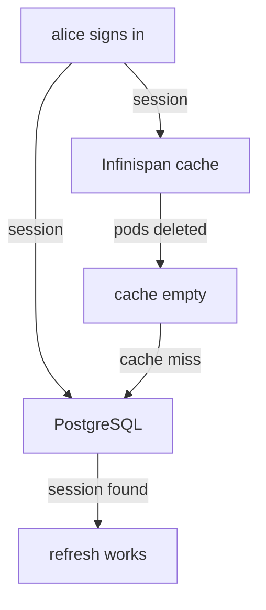

# The Database Is The Source Of Truth

When a Keycloak pod dies, what is lost? The answer decides how you back Keycloak up, how many pods you need, and what a cluster must share. This part looks at the database first, because in Keycloak 26 it holds more than most people expect: not only realms and users, but also the sessions of signed-in users.

## What Keycloak writes to the database

Keycloak keeps everything it must not lose in a relational database, here PostgreSQL. That covers every realm and its settings, every client, every role and group, every user with the hash of their password, and the keys the realm signs tokens with. It also covers **user sessions**: since Keycloak 26, persistent user sessions are switched on by default, so each signed-in session is written to the database as well as to the cache. The older behaviour, sessions kept only in memory, is deprecated since 26.8.

Look at the database your playground uses. The `Keycloak` resource names it in its `db` block:

<!-- astrona:playground:renew -->

```sh
kubectl -n keycloak get keycloak keycloak -o jsonpath='{.spec.db}' | jq
```

The block names the vendor, the host, the database and the two Secret keys for the credentials. The resource also accepts a full JDBC address in `db.url`, a `db.schema`, and three fields for the connection pool: `poolInitialSize`, `poolMinSize` and `poolMaxSize`. A connection pool is a set of open database connections that each Keycloak pod keeps and reuses. Every instance opens its own pool, so two instances with a maximum of 100 connections each can open up to 200 connections to PostgreSQL. Size the database for the sum.

Now open the database itself. PostgreSQL runs in the pod `postgres`, and `psql` is its command-line client:

```sh
kubectl -n keycloak exec deploy/postgres -- psql -U keycloak -d keycloak -c 'select name, enabled from realm;'
kubectl -n keycloak exec deploy/postgres -- psql -U keycloak -d keycloak -c '\dt' | wc -l
```

The first command lists the realms `master` and `inventory`: the same realms the console shows, read straight from the table. The second command counts the lines of the table list, and the number is large, because Keycloak keeps its data in many tables. You never write to these tables yourself, but reading them is the quickest proof of where the data lives.

## A session outlives its pod

Sessions in the database have a direct result you can test: a user stays signed in when the pod that signed them in is deleted. Request tokens for `alice` from the `tester` pod and keep the refresh token. A refresh token is the token a client sends to get new tokens without asking the user again, and Keycloak accepts it only while the user's session exists. The request uses the password grant, which OAuth 2.1 drops; here it only gives you a session from a terminal:

```sh
REFRESH_TOKEN=$(kubectl -n keycloak exec deploy/tester -- \
  curl -s http://keycloak-service:8080/realms/inventory/protocol/openid-connect/token \
    -d grant_type=password -d client_id=inventory-cli \
    -d username=alice -d password=alice-password | jq -r .refresh_token)
echo "${REFRESH_TOKEN:0:20}"
```

The command prints the start of the refresh token. Now delete both Keycloak pods. The StatefulSet creates them again, and for a short time no Keycloak runs at all, so every session that lived only in memory is gone:

```sh
kubectl -n keycloak delete pod keycloak-0 keycloak-1
kubectl -n keycloak wait keycloak/keycloak --for=condition=Ready --timeout=600s
```

When the resource is ready again, use the refresh token:

```sh
kubectl -n keycloak exec deploy/tester -- \
  curl -s http://keycloak-service:8080/realms/inventory/protocol/openid-connect/token \
    -d grant_type=refresh_token -d client_id=inventory-cli \
    -d refresh_token="$REFRESH_TOKEN" | jq -r 'if .access_token then "new access token issued" else . end'
```

The answer says that a new access token was issued. The session survived a moment with no Keycloak running at all, because Keycloak read it back from PostgreSQL.



The diagram shows a session written to both the cache and the database, and the database answering when the cache is empty after a restart.

## What the database does not replace

If the database already holds sessions, why do the instances need to talk to each other at all? Because the database is slow compared with memory, and because some data changes on one pod and must reach the other at once. Each pod keeps copies of realms, clients and users in local caches. When an administrator changes a client on one pod, the other pod must learn that its copy is stale. Short-lived data, such as a sign-in that is halfway through a form or a count of failed logins, is never written to the database at all. Both cases need the pods to share their caches, and that is the job of Infinispan.

You now know what Keycloak writes to PostgreSQL, how the `Keycloak` resource points at it, and that user sessions survive a full restart because they are in the database. The open question is how two pods share the data that is not there, and how you can tell whether they do.

## Common pitfalls

> [!WARNING]
> - **Treating the Keycloak pods as the place where data lives.** Everything that must survive is in the database. Back up and protect the database, not the pods.
> - **Sizing the database for one instance.** Each instance opens its own connection pool; multiply `poolMaxSize` by the number of instances.
> - **Writing to Keycloak's tables by hand.** The pods keep cached copies and never see the change. Change data through the Admin REST API, `kcadm.sh` or the console.
> - **Expecting every piece of data to survive a restart.** A sign-in that is halfway through, and the count of failed logins, live only in the caches.
