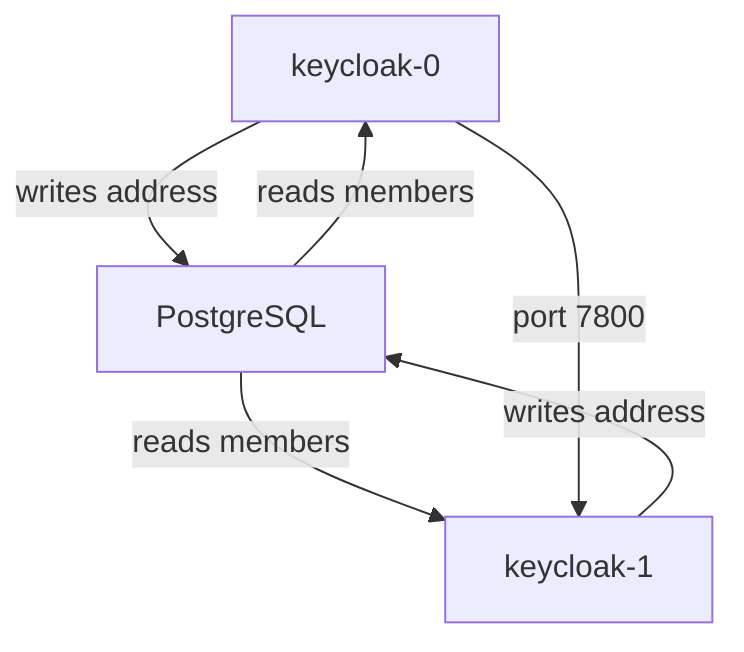

# Infinispan Caches And Cluster Discovery

Two Keycloak pods that do not share their caches still answer every request, so the problem stays hidden in normal use. It shows up later: a client change on one pod that the other ignores, a lockout counter that resets when the request switches pods, a sign-in form that fails halfway through. This part explains the caches, how the pods find each other, and the two signals that prove they really form one cluster.

## Three kinds of cache

Infinispan is the data grid library inside Keycloak. It holds Keycloak's caches and connects the instances into one cluster. Each Keycloak cache is one of three kinds, and the kind decides what happens when there are two pods:

| Kind | Where an entry lives | Keycloak caches of this kind |
| --- | --- | --- |
| Local | On one pod only, as a copy of data from the database | `realms`, `users`, `authorization`, `keys`, `crl` |
| Distributed | On a set number of pods (the owners), reachable from every pod | `authenticationSessions`, `sessions`, `clientSessions`, `offlineSessions`, `offlineClientSessions`, `loginFailures`, `actionTokens` |
| Replicated | On every pod | `work` |

The local caches are copies, so each pod may keep its own; what matters is that a pod learns when its copy is out of date. That is the job of the replicated `work` cache: when one pod changes a realm, it puts an invalidation message in `work`, and every other pod drops its copy. The distributed caches hold data that exists nowhere else, or that must be the same on every pod, such as an authentication session (a sign-in that is in progress) or the count of failed logins for brute force detection.

All of this works only if the pods are members of one Infinispan cluster. In production mode, which the operator always uses, the cache setting `cache` is `ispn`, the clustered mode. The other value, `local`, gives each pod private caches and no cluster at all. It is the default only in development mode.

## How the pods find each other

Pods come and go, and their IP addresses change, so Infinispan needs a way to discover the other members. Keycloak calls this the cache stack, and the default is `jdbc-ping`. With `jdbc-ping`, each instance writes its own address into a table in the same database Keycloak already uses, and reads the addresses of the others from there. No extra Service or cloud API is needed. The older stacks (`kubernetes`, `tcp`, `udp` and the cloud ones) are deprecated.



The diagram shows both pods registering in the database, reading each other's address, and then talking directly on port `7800`.

After discovery the pods talk directly. Infinispan uses port `7800` for data and port `57800` to notice when a member fails. The operator's network policy keeps these ports closed to everything except the Keycloak pods themselves. Leave `spec.networkPolicy.enabled` at its default of `true`: switching it off does not help clustering, and it opens the clustering ports to every pod in the cluster.

## Two signals that prove a cluster

Infinispan logs a line every time the membership changes. Its ID is `ISPN000094`, and it lists the members of the new cluster view with their count. Look for it in both pods:

<!-- astrona:playground:renew -->

```sh
kubectl -n keycloak logs keycloak-0 | grep ISPN000094 | tail -1
kubectl -n keycloak logs keycloak-1 | grep ISPN000094 | tail -1
```

In a healthy cluster the latest line on each pod names both members and shows the count `(2)`. Logs roll over and can be lost when a pod restarts, so the log line is a good first check but a weak proof. The metric is better.

The resource in your playground sets `metrics-enabled` to `true` in `additionalOptions`, so each pod serves metrics on its management port `9000`. The metric `vendor_cluster_size` says how many members that pod sees. Ask each pod directly, by its IP address, from the `tester` pod:

```sh
for pod in keycloak-0 keycloak-1; do
  POD_IP=$(kubectl -n keycloak get pod "$pod" -o jsonpath='{.status.podIP}')
  echo "$pod: $(kubectl -n keycloak exec deploy/tester -- curl -s "http://$POD_IP:9000/metrics" | grep '^vendor_cluster_size')"
done
```

Each pod reports a cluster size of `2`. A pod that runs alone reports `1`, however many pods the StatefulSet has. That number is the proof to trust.

## Break the cluster, then watch it come back

Now see what happens when the pods do not cluster. Switch the cache to `local` through `additionalOptions`. The patch replaces the whole list, so it keeps the two existing options:

```sh
kubectl -n keycloak patch keycloak keycloak --type merge -p \
  '{"spec":{"additionalOptions":[{"name":"health-enabled","value":"true"},{"name":"metrics-enabled","value":"true"},{"name":"cache","value":"local"}]}}'
kubectl -n keycloak wait keycloak/keycloak --for=condition=Ready --timeout=600s
```

Run the metric loop from the previous step again. Each pod now reports a cluster size of `1`: two pods, two separate servers, sharing only the database. Nothing else in `kubectl get pods` changed; both pods are `Running` and ready. That is why the metric matters.

A token issued by one pod is still accepted by the other, because the session is in the database and the signing keys are the same. So a token test alone does not prove a cluster. Try it anyway, to see the difference between the two kinds of proof. Get a token from `keycloak-0` directly, then send it to the `userinfo` endpoint of `keycloak-1`. The `userinfo` endpoint returns the claims of the signed-in user when it receives a valid access token:

```sh
POD0_IP=$(kubectl -n keycloak get pod keycloak-0 -o jsonpath='{.status.podIP}')
POD1_IP=$(kubectl -n keycloak get pod keycloak-1 -o jsonpath='{.status.podIP}')
ACCESS_TOKEN=$(kubectl -n keycloak exec deploy/tester -- \
  curl -s "http://$POD0_IP:8080/realms/inventory/protocol/openid-connect/token" \
    -d grant_type=password -d client_id=inventory-cli \
    -d username=alice -d password=alice-password -d scope=openid | jq -r .access_token)
kubectl -n keycloak exec deploy/tester -- \
  curl -s -H "Authorization: Bearer $ACCESS_TOKEN" \
    "http://$POD1_IP:8080/realms/inventory/protocol/openid-connect/userinfo" | jq -r .preferred_username
```

The answer is `alice`, even with two separate servers. The token request uses the password grant, which OAuth 2.1 drops; it is used here only to test from a terminal. Put the cluster back by removing the `cache` option again:

```sh
kubectl -n keycloak patch keycloak keycloak --type merge -p \
  '{"spec":{"additionalOptions":[{"name":"health-enabled","value":"true"},{"name":"metrics-enabled","value":"true"}]}}'
kubectl -n keycloak wait keycloak/keycloak --for=condition=Ready --timeout=600s
```

You now know the three kinds of cache, how `jdbc-ping` lets pods find each other through the database, and the two signals of a real cluster: an `ISPN000094` view with every member, and `vendor_cluster_size` equal to the number of instances on every pod. You have also seen that a working token proves less than it seems.

## Common pitfalls

> [!WARNING]
> - **Counting pods instead of members.** Two ready pods can be two separate servers. Check `vendor_cluster_size` on every pod.
> - **Setting `cache` to `local` to make a warning go away.** Each pod then runs alone, and lockout counters and in-progress sign-ins stop being shared.
> - **Switching off the operator's network policy to "help" clustering.** The policy already lets the Keycloak pods reach each other; switching it off only opens ports `7800` and `57800` to every pod.
> - **Proving a cluster with a token alone.** Sessions and keys come from the database, so a token works across pods even with no cluster.

## Your mission: Join Two Keycloak Instances Into One Cluster

You can now prove whether Keycloak instances form one cluster, and find the setting that keeps them apart. The graded lab gives you a `Keycloak` resource with two ready pods that do not form a cluster, and asks you to join them without lowering the instance count or opening the clustering ports.

The lab runs in its own cluster, so first pause your playground. Nothing in it is lost:

```sh
astrona stop ats-093-playground-020-01
```

Then start the lab:

```sh
astrona run --git ssh://git@github.com/astrona-io/ATS093.git -c sections/section-020/module-01/labs/lab-01
```

The task is on the next page. Solve it on your own first. When you think you are done, send it for grading:

```sh
astrona submit -c sections/section-020/module-01/labs/lab-01
```

When the lab is done, remove it and start your playground again:

```sh
astrona destroy ats-093-lab-020-01
astrona start ats-093-playground-020-01
```
