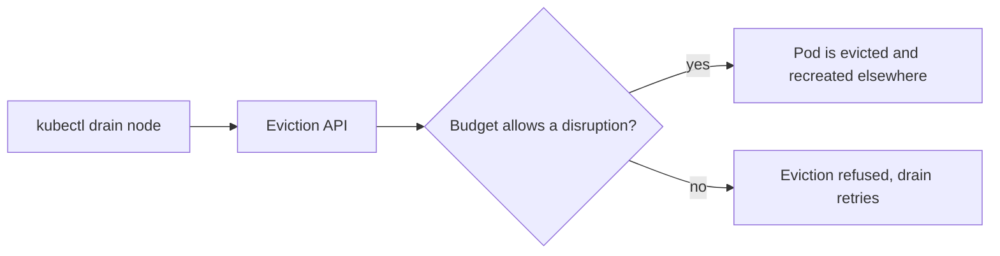

# Planned And Unplanned Disruption

Kubernetes divides the loss of a pod into two kinds, and only one of them can be controlled.

## Two kinds of disruption

An involuntary disruption is a failure: a node loses power, the kernel kills a pod for running out of memory, a network link breaks. Nobody asked for it, and nothing can veto it. You protect against it with more pods and with spreading them out.

A voluntary disruption is an action someone requested: a node drain before maintenance, a cluster upgrade that replaces nodes, the cluster autoscaler removing a node that is mostly empty, a person deleting a pod. These go through the eviction API, and the eviction API can say no. A `PodDisruptionBudget` is the rule that it checks.

## What a budget says

A budget selects pods with a label selector and sets one of two limits:

| Field | Meaning | With two pods |
| --- | --- | --- |
| `minAvailable: 1` | At least one selected pod must stay available | One pod may be evicted |
| `maxUnavailable: 1` | At most one selected pod may be unavailable | One pod may be evicted |
| `minAvailable: 2` | Both pods must stay available | No pod may be evicted |
| `maxUnavailable: 0` | No pod may be unavailable | No pod may be evicted |

A budget takes only one of the two fields. The status shows the result as `ALLOWED DISRUPTIONS`, the number of pods that can go right now. When it is `0`, an eviction is refused and a `kubectl drain` waits and retries. A budget with `minAvailable` equal to the number of pods therefore blocks every drain, which is the most common mistake.

The budget counts only pods that are Ready. If one pod is already down, `minAvailable: 1` allows no further eviction, because only one pod is available. That is the right behaviour: the budget protects the last pod.



The diagram shows a drain going through the eviction API, which asks the budget before a pod is removed.

## Writing a budget for Keycloak

The operator creates the pods through a StatefulSet, and the `Keycloak` resource of this version has no field for a budget. Write one yourself. The selector must match the pod labels, and the safest source is the StatefulSet itself:

```sh
kubectl -n keycloak get statefulset keycloak -o jsonpath='{.spec.selector.matchLabels}{"\n"}'
```

Use the labels it prints in a budget:

```yaml
apiVersion: policy/v1
kind: PodDisruptionBudget
metadata:
  name: keycloak
  namespace: keycloak
spec:
  maxUnavailable: 1
  selector:
    matchLabels:
      app: keycloak
```

Replace the `matchLabels` with what your command printed. Then read the status:

```sh
kubectl -n keycloak get pdb keycloak
kubectl -n keycloak get pdb keycloak -o jsonpath='{.status.expectedPods} {.status.disruptionsAllowed}{"\n"}'
```

`expectedPods` of `0` means the selector matched nothing, so the budget protects nothing. Always check that number.

## What a budget does not do

A budget does not stop involuntary failures and does not stop a person who deletes a pod with `kubectl delete pod`; a delete is not an eviction. It also does not restart anything. It only makes a drain wait. Use `maxUnavailable: 1` for a cluster of any size above one unless you can show that more can be lost at once, because it grows with the number of pods and never blocks the drain completely.

## Mission

A budget written by the platform team makes node drains hang. In the graded lab you read the budget, see why it allows no disruption, and change the rule so one pod can be evicted at a time.

<!-- astrona:playground:renew -->
