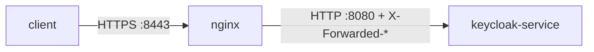

# TLS Termination Modes And Proxy Headers

A client that signs in through a proxy sees one address, for example `https://keycloak.localtest.me:8443`. Keycloak, behind the proxy, may see a plain HTTP request to `keycloak-service:8080`. Keycloak writes its own address into every token, every redirect and every discovery document, so it must use the address the client sees, not the one it receives. This part explains the three ways a proxy can handle TLS, and the two settings that tell Keycloak what the outside world sees.

## Three ways to handle TLS at a proxy

TLS (Transport Layer Security) encrypts the connection between a client and a server. When a proxy sits in between, it can handle TLS in one of three ways, and each one needs different Keycloak settings:

| Mode | What the proxy does | Keycloak settings |
| --- | --- | --- |
| Edge termination | Ends TLS and sends plain HTTP to Keycloak | `http-enabled=true` and `proxy-headers` |
| Re-encrypt | Ends TLS and opens a new TLS connection to Keycloak | `proxy-headers`, plus a certificate for Keycloak |
| Passthrough | Forwards the TLS connection untouched; Keycloak ends it | `proxy-protocol-enabled=true` and **no** `proxy-headers` |

Edge termination is the simplest, and it is what this module uses. The Keycloak documentation calls it less secure than re-encrypt, because the traffic between the proxy and Keycloak is not encrypted. Inside one cluster with a network policy that is often accepted. Across a network you do not control, re-encrypt is the recommended mode. In passthrough the proxy cannot read the request at all, so it cannot add headers, and Keycloak must not trust any: the two options `proxy-headers` and `proxy-protocol-enabled` cannot be used together.



The diagram shows edge termination: the client speaks HTTPS to nginx, and nginx forwards plain HTTP to Keycloak with headers that describe the original request.

## The hostname and the proxy headers

Two settings tell Keycloak about the outside world. The first is the **hostname**: the public address Keycloak puts in every URL it builds. In a `Keycloak` resource it is `spec.hostname.hostname`, and as a full URL it fixes the scheme, the host and the port. A second field, `spec.hostname.admin`, gives the administration console its own address, so the console can live on an internal URL that the public proxy never forwards.

The second setting is **`proxy-headers`**, `spec.proxy.headers` in the resource. It tells Keycloak to read the headers a proxy adds to each request: `forwarded` for the standard `Forwarded` header, or `xforwarded` for the `X-Forwarded-For`, `X-Forwarded-Proto`, `X-Forwarded-Host` and `X-Forwarded-Port` headers. From them Keycloak learns the client's real IP address and that the original request used HTTPS. The proxy must overwrite these headers, never append to what the client sent, or a client could claim any address it likes. The option `proxy-trusted-addresses` goes one step further and accepts the headers only from the proxy's own addresses.

Read the settings of the `Keycloak` resource in your playground:

<!-- astrona:playground:renew -->

```sh
kubectl -n keycloak get keycloak keycloak -o jsonpath='{.spec.hostname} {.spec.proxy} {.spec.http}{"\n"}'
```

The hostname is `https://keycloak.localtest.me:8443`, the administration console is at `http://localhost:8080`, the proxy headers are `xforwarded`, and HTTP is enabled: the settings for edge termination.

## Look at Keycloak through the proxy

Now ask for the discovery document of the realm `inventory` the way an outside client would, through nginx. The helper below finds the IP address of the nginx Service and calls `curl` with `--resolve`, so the request uses the public name. Paste it once in your terminal:

```sh
proxy_curl() {
  NGINX_IP=$(kubectl -n keycloak get service nginx -o jsonpath='{.spec.clusterIP}')
  kubectl -n keycloak exec deploy/tester -- curl -sk \
    --resolve "keycloak.localtest.me:8443:$NGINX_IP" "${@:2}" "https://keycloak.localtest.me:8443$1"
}
proxy_curl /realms/inventory/.well-known/openid-configuration | jq -r '.issuer, .token_endpoint'
```

Both addresses start with `https://keycloak.localtest.me:8443`, the address the client used. Now ask Keycloak directly, past the proxy, on its internal Service:

```sh
kubectl -n keycloak exec deploy/tester -- \
  curl -s http://keycloak-service:8080/realms/inventory/.well-known/openid-configuration | jq -r .issuer
```

The issuer is the same `https://` address. With a full URL as the hostname, Keycloak builds the same public addresses whichever way a request arrives. That is what makes a token valid no matter which path it came through: an API that checks the issuer always sees one value.

## What happens without the hostname

To see why the hostname matters, set it back to the internal address for a moment. Without `proxy.headers` as well, Keycloak has no way to learn the public address at all:

```sh
kubectl -n keycloak patch keycloak keycloak --type json -p '[
  {"op":"replace","path":"/spec/hostname","value":{"hostname":"http://keycloak-service:8080"}},
  {"op":"remove","path":"/spec/proxy"}]'
kubectl -n keycloak wait keycloak/keycloak --for=condition=Ready --timeout=600s
proxy_curl /realms/inventory/.well-known/openid-configuration | jq -r .issuer
```

Wait for the operator to replace the pod before the last command answers; if the wait returns at once, run the last command again after a minute. The issuer is now `http://keycloak-service:8080/realms/inventory`, an address no outside client can reach, over plain HTTP. A browser application would follow that address for its sign-in redirect and fail. Put the edge settings back:

```sh
kubectl -n keycloak patch keycloak keycloak --type merge -p \
  '{"spec":{"hostname":{"hostname":"https://keycloak.localtest.me:8443","admin":"http://localhost:8080"},"proxy":{"headers":"xforwarded"}}}'
kubectl -n keycloak wait keycloak/keycloak --for=condition=Ready --timeout=600s
```

You now know the three TLS modes and what each needs from Keycloak, and how the hostname and the proxy headers make Keycloak build the address the client sees. The proxy in your playground forwards the right requests with the right headers. The next question is which requests it should forward at all.

## Common pitfalls

> [!WARNING]
> - **Ending TLS at the proxy without telling Keycloak.** Tokens and redirects then carry `http://` and the internal address. Set the public hostname and `proxy.headers`.
> - **Setting `proxy-headers` with passthrough.** The proxy cannot add headers to a TLS stream it does not read; use `proxy-protocol-enabled` instead.
> - **Letting the proxy append to `X-Forwarded-*` headers from the client.** A client can then pretend to come from any address. The proxy must overwrite them.
> - **Choosing `forwarded` when the proxy sends `X-Forwarded-*` (or the other way round).** Keycloak reads only the format you name.
