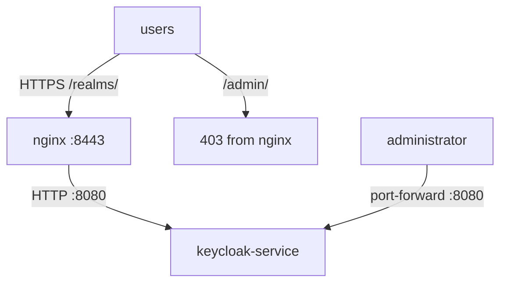

# What To Expose Through The Proxy

A proxy that forwards every path makes Keycloak's whole surface public: the sign-in pages that must be public, and also the administration console, the `master` realm with its administrator accounts, and the management endpoints that report health and metrics. This part decides which paths an edge proxy forwards, configures nginx to do exactly that, and keeps a separate way in for administrators.

## The paths and where they belong

Keycloak serves everything from a few path prefixes. The Keycloak reverse proxy guide sorts them into public and internal:

| Path | Expose through the proxy? | Why |
| --- | --- | --- |
| `/realms/` | Yes | The OpenID Connect and SAML endpoints, sign-in pages and the account console of every realm |
| `/resources/` | Yes | Images, scripts and stylesheets for the sign-in pages |
| `/.well-known/` | Yes | Server metadata that some clients look up |
| `/realms/master/` | No, internal only | The realm of the administrators |
| `/admin/` | No, internal only | The administration console and the Admin REST API |
| `/` | No | Only a redirect page |
| `/metrics`, `/health` | No | Management endpoints on port `9000`; they reveal internal state |

The rule behind the table: **the public needs to sign in, not to administer.** Administrators reach the console on an internal address, here `http://localhost:8080` through a port-forward, which is why the `Keycloak` resource sets `hostname.admin` to that address. The management port `9000` is never proxied at all; only port `8080` (or `8443` with TLS) belongs behind the proxy.

## Read the nginx configuration

nginx reads its configuration from the ConfigMap `nginx-conf`, mounted as a file into `/etc/nginx/conf.d/`. Print it:

<!-- astrona:playground:renew -->

```sh
kubectl -n keycloak get configmap nginx-conf -o jsonpath='{.data.keycloak\.conf}'
```

The configuration has one `server` block that listens on port `8443` with TLS and the certificate from the Secret `edge-tls`. The four `proxy_set_header` lines overwrite the `X-Forwarded-*` headers on every forwarded request. Then come the `location` blocks, which nginx matches against the request path. nginx picks the block with the longest matching prefix, so `/realms/master/` wins over `/realms/` for a request to the master realm:

| Directive | What it does here |
| --- | --- |
| `location /admin/ { return 403; }` | Answers `403 Forbidden` itself; the request never reaches Keycloak |
| `location /realms/master/ { return 403; }` | Same for the master realm |
| `location /realms/ { proxy_pass ...; }` | Forwards the request to `keycloak-service:8080` |
| `location / { return 404; }` | Answers `404 Not Found` for every path not listed |

## Test every path from the outside

Check the configuration the way an attacker would: request each path through the proxy and print only the HTTP status code. Paste the `proxy_curl` helper first if this is a new terminal:

```sh
proxy_curl() {
  NGINX_IP=$(kubectl -n keycloak get service nginx -o jsonpath='{.spec.clusterIP}')
  kubectl -n keycloak exec deploy/tester -- curl -sk \
    --resolve "keycloak.localtest.me:8443:$NGINX_IP" "${@:2}" "https://keycloak.localtest.me:8443$1"
}
for request_path in /realms/inventory/.well-known/openid-configuration /admin/master/console/ \
    /realms/master/.well-known/openid-configuration /metrics /health/ready /; do
  echo "$request_path $(proxy_curl "$request_path" -o /dev/null -w '%{http_code}')"
done
```

The discovery document of `inventory` answers `200`. The administration console and the master realm answer `403`, and the other paths answer `404`, all from nginx itself. Nothing but the public paths reaches Keycloak.

## Keep a way in for administrators

Blocking the console at the proxy is only half of the job; administrators still need it. The internal address in `hostname.admin` is `http://localhost:8080`, so the console works through a port-forward to the Keycloak Service. Start one in a second terminal and leave it running:

```sh
kubectl -n keycloak port-forward svc/keycloak-service 8080:8080
```

Then open `http://localhost:8080/admin/` in your browser and sign in with the initial administrator. Its user name and password are in the Secret `keycloak-initial-admin`:

```sh
kubectl -n keycloak get secret keycloak-initial-admin -o jsonpath='{.data.username}' | base64 -d; echo
kubectl -n keycloak get secret keycloak-initial-admin -o jsonpath='{.data.password}' | base64 -d; echo
```

The console loads and works, on an address only someone with access to the cluster can open. On a real system the same idea uses an internal load balancer or a VPN instead of a port-forward. Stop the port-forward with `Ctrl+C` when you are done.



The diagram shows the two ways in: users through nginx, which forwards only the public paths, and administrators straight to the Keycloak Service on an internal address.

You now know which paths an edge proxy forwards and which it answers itself, how to prove it with one request per path, and how administrators keep their own way in. Together with the hostname and proxy headers, that is a complete edge configuration.

## Common pitfalls

> [!WARNING]
> - **Forwarding `/` to Keycloak.** A catch-all forward exposes `/admin/` and the master realm with everything else.
> - **Blocking `/admin/` and forgetting `/realms/master/`.** The master realm's sign-in and token endpoints are still public, and its administrator accounts can be attacked there.
> - **Proxying the management port.** `/metrics` and `/health` belong to port `9000` and to monitoring inside the cluster only.
> - **Changing the ConfigMap and expecting nginx to notice.** nginx reads its configuration at start; restart the Deployment after each change.

## Your mission: Expose Keycloak Through An Edge Proxy

You can now set up an edge proxy that forwards only the public paths, with a Keycloak that knows its public address. The graded lab gives you an nginx that forwards everything with no proxy headers, and a Keycloak that still uses its internal address, and asks you to make the public issuer right and the administration paths private.

The lab runs in its own cluster, so first pause your playground. Nothing in it is lost:

```sh
astrona stop ats-093-playground-030-01
```

Then start the lab:

```sh
astrona run --git ssh://git@github.com/astrona-io/ATS093.git -c sections/section-030/module-01/labs/lab-01
```

The task is on the next page. Solve it on your own first. When you think you are done, send it for grading:

```sh
astrona submit -c sections/section-030/module-01/labs/lab-01
```

When the lab is done, remove it and start your playground again:

```sh
astrona destroy ats-093-lab-030-01
astrona start ats-093-playground-030-01
```
