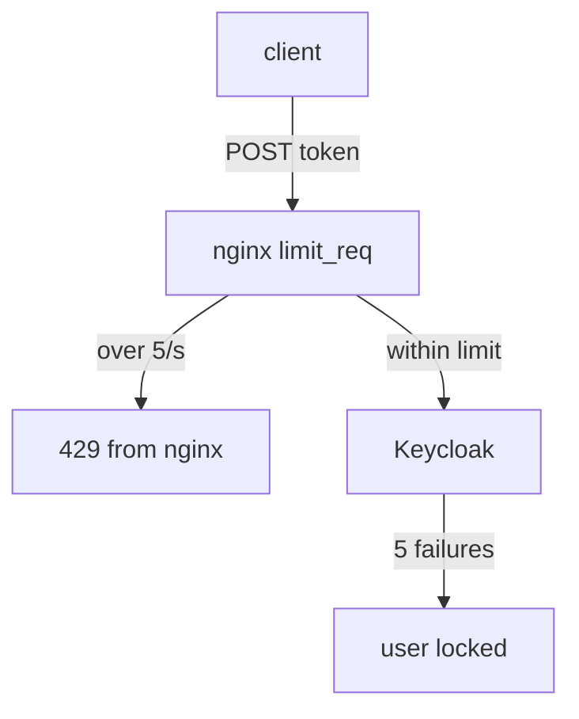

# Brute Force Detection And Rate Limiting

A public token endpoint accepts a user name and a password from anyone. Without limits, a script can try thousands of passwords for one user, or flood the endpoint until real users cannot sign in. Two defences work together here. Keycloak's brute force detection locks one user out after too many failures, and a rate limit at the proxy caps how fast any client may send requests. This part sets up both and proves each one.

## Brute force detection in the realm

Brute force detection is a realm setting. When it is on, Keycloak counts failed logins per user, and after a set number it locks the user out, for a while or for good. The count lives in the distributed `loginFailures` cache, so every Keycloak instance in a cluster sees the same number. The settings are fields of the realm, with these names in the Admin REST API:

| Field | What it does |
| --- | --- |
| `bruteForceProtected` | Turns detection on |
| `failureFactor` | Failed logins before a lockout |
| `permanentLockout` | `true` locks the user until an administrator unlocks them; `false` locks them for a time |
| `waitIncrementSeconds` | How long a temporary lockout lasts, growing with repeated lockouts |
| `maxFailureWaitSeconds` | The longest a temporary lockout can last |
| `maxDeltaTimeSeconds` | After this time without failures, the count starts again from zero |

A temporary lockout is the usual choice. A permanent one lets any stranger lock any user out for good just by knowing the user name.

Sign `kcadm.sh` in with the initial admin Secret, then switch detection on for `inventory` with a temporary lockout after five failures:

<!-- astrona:playground:renew -->

```sh
kcadm() {
  kubectl -n keycloak exec -i keycloak-0 -- \
    /opt/keycloak/bin/kcadm.sh "$@" --config /tmp/kcadm.config
}
kcadm config credentials --server http://localhost:8080 --realm master \
  --user "$(kubectl -n keycloak get secret keycloak-initial-admin -o jsonpath='{.data.username}' | base64 -d)" \
  --password "$(kubectl -n keycloak get secret keycloak-initial-admin -o jsonpath='{.data.password}' | base64 -d)"
kcadm update realms/inventory -s bruteForceProtected=true -s failureFactor=5 \
  -s permanentLockout=false -s waitIncrementSeconds=60 -s maxFailureWaitSeconds=900
```

Now act like an attacker. Send six wrong passwords for the test user `bob` from the `tester` pod, straight to the Keycloak Service. Each request uses the password grant, which OAuth 2.1 drops; it is the simplest way to try a password from a terminal:

```sh
for attempt in 1 2 3 4 5 6; do
  kubectl -n keycloak exec deploy/tester -- \
    curl -s -o /dev/null -w '%{http_code} ' http://keycloak-service:8080/realms/inventory/protocol/openid-connect/token \
      -d grant_type=password -d client_id=inventory-cli -d username=bob -d password=wrong-password
done; echo
```

Every attempt answers `401`. Keycloak gives the same answer before and after the lockout, so an attacker cannot tell when it started. The lockout state is visible to administrators in the Admin REST API, under `attack-detection`:

```sh
BOB_ID=$(kcadm get users -r inventory -q username=bob -q exact=true --fields id --format csv --noquotes)
kcadm get attack-detection/brute-force/users/$BOB_ID -r inventory
```

The answer shows `disabled` as `true` and the number of failures. Even the right password fails now, until the lockout ends. An administrator can end it early by deleting the entry:

```sh
kcadm delete attack-detection/brute-force/users/$BOB_ID -r inventory
```

## A rate limit at the proxy

Brute force detection protects one user at a time. It does nothing against a client that tries one password each for thousands of different users, or that simply sends more requests than Keycloak can answer. That is the proxy's job. nginx limits the request rate with two directives: `limit_req_zone` defines a shared counter, keyed here by the client's IP address, with a rate, and `limit_req` applies it to a location, with a burst of extra requests it lets through at once. `limit_req_status 429` makes nginx answer `429 Too Many Requests` instead of its default `503`.

The configuration below keeps everything the playground's nginx already does, and adds a limit of five requests per second, with a burst of five, on the token endpoint of every realm.

Save this as `configmap-nginx-conf.yaml`:

```yaml
apiVersion: v1
kind: ConfigMap
metadata:
  name: nginx-conf
  namespace: keycloak
data:
  keycloak.conf: |
    limit_req_zone $binary_remote_addr zone=token_endpoint:10m rate=5r/s;

    server {
      listen 8443 ssl;
      server_name keycloak.localtest.me;
      ssl_certificate     /etc/nginx/tls/tls.crt;
      ssl_certificate_key /etc/nginx/tls/tls.key;

      proxy_set_header X-Forwarded-For   $proxy_add_x_forwarded_for;
      proxy_set_header X-Forwarded-Proto $scheme;
      proxy_set_header X-Forwarded-Host  $host;
      proxy_set_header X-Forwarded-Port  $server_port;

      location /admin/        { return 403; }
      location /realms/master/ { return 403; }

      location ~ ^/realms/[^/]+/protocol/openid-connect/token$ {
        limit_req zone=token_endpoint burst=5 nodelay;
        limit_req_status 429;
        proxy_pass http://keycloak-service:8080;
      }

      location /realms/      { proxy_pass http://keycloak-service:8080; }
      location /resources/   { proxy_pass http://keycloak-service:8080; }
      location /.well-known/ { proxy_pass http://keycloak-service:8080; }

      location / { return 404; }
    }
```

Apply it:

```sh
kubectl apply -f configmap-nginx-conf.yaml
```

Then restart nginx so it reads the new file, and check the result with a burst of 20 requests through the proxy, as fast as the `tester` pod can send them:

```sh
kubectl -n keycloak rollout restart deployment/nginx
kubectl -n keycloak rollout status deployment/nginx
NGINX_IP=$(kubectl -n keycloak get service nginx -o jsonpath='{.spec.clusterIP}')
kubectl -n keycloak exec deploy/tester -- sh -c "for attempt in \$(seq 1 20); do \
  curl -sk -o /dev/null -w '%{http_code} ' --resolve keycloak.localtest.me:8443:$NGINX_IP \
    https://keycloak.localtest.me:8443/realms/inventory/protocol/openid-connect/token \
    -d grant_type=password -d client_id=inventory-cli -d username=bob -d password=wrong-password; done; echo"
```

The first answers are `401` from Keycloak, and then the `429` answers start: nginx refused those requests itself, and Keycloak never saw them. The `~` in the location makes it a regular expression, which nginx checks before the plain `/realms/` prefix, so only the token endpoint is limited and the sign-in pages are not.



The diagram shows the two layers: nginx drops requests above the rate before they reach Keycloak, and Keycloak locks a user after five failed passwords among the requests that do arrive.

The burst also counted against `bob`, so unlock the user again with the `kcadm delete` command from above. You now know how to lock out a user under attack and how to cap the request rate at the proxy, and why both are needed: one protects each account, the other protects the server.

## Common pitfalls

> [!WARNING]
> - **Choosing a permanent lockout.** Anyone who knows a user name can lock that user out for good. Prefer a temporary lockout.
> - **Rate limiting only by user.** Brute force detection already counts per user; the proxy must limit per client address to stop attacks spread across many users.
> - **Limiting every path.** A low rate on `/resources/` breaks the sign-in page, which loads several files at once. Limit the token endpoint.
> - **Keying the rate limit on a header the client sets.** Use the connection's address (`$binary_remote_addr`), which the client cannot fake.

## Your mission: Stop Password Guessing

You can now switch on brute force detection and a rate limit, and prove both with requests. The graded lab gives you a working edge with neither, and asks you to lock out a user after five failures and to answer a burst at the token endpoint with `429`, while normal sign-ins keep working.

The lab runs in its own cluster, so first pause your playground. Nothing in it is lost:

```sh
astrona stop ats-093-playground-030-01
```

Then start the lab:

```sh
astrona run --git ssh://git@github.com/astrona-io/ATS093.git -c sections/section-030/module-01/labs/lab-02
```

The task is on the next page. Solve it on your own first. When you think you are done, send it for grading:

```sh
astrona submit -c sections/section-030/module-01/labs/lab-02
```

When the lab is done, remove it and start your playground again:

```sh
astrona destroy ats-093-lab-030-01-02
astrona start ats-093-playground-030-01
```
