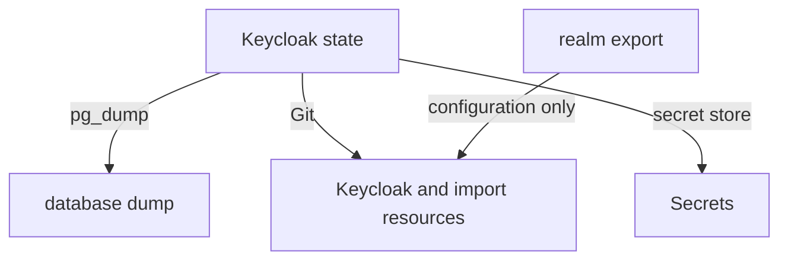

# What To Back Up

Before you take a backup, you need to know what you are protecting. Keycloak's state is spread over three places: the database, the Kubernetes resources that describe the deployment, and the Secrets those resources point at. Each has a different backup method, and one tempting method, the realm export, protects less than it seems. This part sorts it all out.

## The database holds the state

Everything Keycloak knows lives in its database: every realm and its settings, every client with its secret, every user with the hash of their password and their one-time-password devices, the realm signing keys, and, since Keycloak 26, the user sessions. Lose the database and every user has to be created again, every client secret changes, and every token ever issued stops validating, because the signing keys are gone.

Count what is at stake in your playground. `psql` is PostgreSQL's command-line client, and it runs inside the `postgres` pod:

<!-- astrona:playground:renew -->

```sh
kubectl -n keycloak exec deploy/postgres -- psql -U keycloak -d keycloak -c 'select name from realm;'
kubectl -n keycloak exec deploy/postgres -- psql -U keycloak -d keycloak -c 'select count(*) from user_entity;'
```

The first command lists the realms `master`, `inventory` and `restore-check`. The second counts the users of all realms, administrators included. All of them exist only in this database.

## The resources and the Secrets

The second place is the Kubernetes side: the `Keycloak` resource, any `KeycloakRealmImport` resources, and the nginx or Ingress configuration in front. These are small text files, and the right place for them is a Git repository, where every change is recorded. Print the custom resources the way you would save them:

```sh
kubectl -n keycloak get keycloak,keycloakrealmimport -o yaml | head -30
```

The output holds the `spec` you wrote, plus a `status` and some fields the API server added. A saved copy for a restore needs only the `metadata.name`, `metadata.namespace` and `spec`; the operator creates the rest again.

The third place is the Secrets the resources point at. The database credentials in `keycloak-db` must match the users in the database, and a TLS certificate must match its private key. List them:

```sh
kubectl -n keycloak get secrets
```

`keycloak-db` and `inventory-secrets` are yours to back up, in a secret store, never in plain text in Git. `keycloak-initial-admin` is different: the operator creates it for a temporary administrator, and after a restore the administrators in the restored `master` realm are the ones that count.

## Why a realm export is not a backup

Keycloak can export a realm as JSON, from the Admin Console or with `kc.sh export`, and that file looks like a backup. It is not one, for three reasons. The partial export from the Admin Console leaves the users out and replaces every secret with `*` characters. A full export with `kc.sh export` includes users, but it must run as a separate server process against the database, not next to a live instance. And neither export holds the user sessions. A realm export is useful to copy a realm's configuration to another cluster, or to seed a `KeycloakRealmImport`; the backup is the database dump.



The diagram shows the three parts of a backup, each with its method, and the realm export as a source of configuration rather than a backup.

One more point decides how often you dump. A dump is a copy of one moment. Anything written after it, a new user, a changed password, a new session, is lost if you restore it later. The time between dumps is the most data you can lose, so choose it on purpose, and test a restore regularly.

You now know the three parts of a Keycloak backup and the right method for each, and why the database dump is the part that cannot be replaced. The next step is to take a dump and restore it.

## Common pitfalls

> [!WARNING]
> - **Backing up the realm export instead of the database.** Users, secrets and sessions are missing or masked.
> - **Saving the custom resources with their `status`.** Applying a saved `status` does nothing; keep `metadata.name`, `metadata.namespace` and `spec`.
> - **Storing the database Secret in Git as plain text.** Use a secret store, or encrypt it before it goes into Git.
> - **Never testing a restore.** A dump that fails to restore is found out on the worst possible day.
