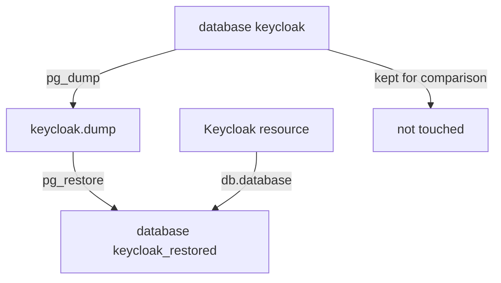

# Dump And Restore The Database

A backup proves its worth only when you restore it. This part goes through the whole loop on your playground: take a dump of the Keycloak database, copy it off the cluster, lose some data on purpose, restore the dump into a new database next to the damaged one, and point Keycloak at it.

## Take a dump

`pg_dump` is PostgreSQL's tool for writing one database to a file. With `-Fc` it writes the custom format, a compressed archive that `pg_restore` can read back table by table. `pg_dump` reads from a consistent snapshot of the database, so Keycloak can keep running while it works; the dump shows the state at the moment the command started. Write the dump to the `/backup` folder of the `postgres` pod:

<!-- astrona:playground:renew -->

```sh
kubectl -n keycloak exec deploy/postgres -- pg_dump -U keycloak -d keycloak -Fc -f /backup/keycloak.dump
kubectl -n keycloak exec deploy/postgres -- ls -l /backup
```

The folder now holds `keycloak.dump`. A dump that stays in the pod it came from does not survive the loss of that pod, so copy it to your machine as well. `kubectl exec` with `cat` streams the file out byte for byte:

```sh
kubectl -n keycloak exec deploy/postgres -- cat /backup/keycloak.dump > keycloak.dump
ls -l keycloak.dump
```

The file on your machine has the same size as the one in the pod. On a real system, this copy goes to object storage or a backup system on a schedule.

## Lose some data

Now make the dump necessary. Delete the realm `restore-check` with `kcadm.sh`, signed in with the operator's initial admin Secret:

```sh
kcadm() {
  kubectl -n keycloak exec -i keycloak-0 -- \
    /opt/keycloak/bin/kcadm.sh "$@" --config /tmp/kcadm.config
}
kcadm config credentials --server http://localhost:8080 --realm master \
  --user "$(kubectl -n keycloak get secret keycloak-initial-admin -o jsonpath='{.data.username}' | base64 -d)" \
  --password "$(kubectl -n keycloak get secret keycloak-initial-admin -o jsonpath='{.data.password}' | base64 -d)"
kcadm delete realms/restore-check
kcadm get realms --fields realm
```

The realm list now shows only `master` and `inventory`. The realm is gone from the live database.

## Restore next to the damaged database

There are two ways to restore: over the damaged database, or into a new one beside it. Restore into a new one. The damaged database stays as it is, so you can still compare the two, copy out anything written after the dump, or go back if the restore itself is wrong. `createdb` creates the new database, and `pg_restore` loads the dump into it. `--no-owner` makes every restored table belong to the user that runs the restore:

```sh
kubectl -n keycloak exec deploy/postgres -- createdb -U keycloak keycloak_restored
kubectl -n keycloak exec deploy/postgres -- pg_restore -U keycloak -d keycloak_restored --no-owner /backup/keycloak.dump
kubectl -n keycloak exec deploy/postgres -- psql -U keycloak -d keycloak_restored -c 'select name from realm;'
```

The restored database lists all three realms, `restore-check` included. The live database `keycloak` still lacks it. Keycloak knows nothing about the new database yet; it still reads `keycloak`.

## Point Keycloak at the restored database

The database name is one field of the `Keycloak` resource, `spec.db.database`. Change it, and the operator restarts the instances against the restored database:

```sh
kubectl -n keycloak patch keycloak keycloak --type merge -p '{"spec":{"db":{"database":"keycloak_restored"}}}'
kubectl -n keycloak rollout status statefulset/keycloak --timeout=600s
kubectl -n keycloak wait keycloak/keycloak --for=condition=Ready --timeout=600s
```

Wait until the rollout is complete; every pod must restart, because each one holds cached copies of the old data. Then check the result. `kcadm.sh` must sign in again, because the pod and its session file are new:

```sh
kcadm config credentials --server http://localhost:8080 --realm master \
  --user "$(kubectl -n keycloak get secret keycloak-initial-admin -o jsonpath='{.data.username}' | base64 -d)" \
  --password "$(kubectl -n keycloak get secret keycloak-initial-admin -o jsonpath='{.data.password}' | base64 -d)"
kcadm get realms --fields realm
```

The realm `restore-check` is back. Everything else is the state of the dump, too: a user created between the dump and the restore would be missing now, and sessions that started after the dump are gone, so those users sign in again.



The diagram shows the dump going into a new database, the `Keycloak` resource switched to it, and the damaged database left untouched.

You now know the full restore loop: dump with `pg_dump -Fc`, copy it off the cluster, restore with `pg_restore` into a new database, and switch `spec.db.database`. You also know what a restore costs: everything written after the dump.

## Common pitfalls

> [!WARNING]
> - **Restoring over the damaged database.** If the restore goes wrong, there is nothing left to go back to. Restore next to it.
> - **Keeping the only copy of the dump in the database pod.** The dump disappears with the pod; copy it off the cluster.
> - **Checking before the rollout is complete.** A pod that still runs against the old database answers with the old data.
> - **Forgetting the data written after the dump.** Users and changes made after the dump are not in the restore; compare with the old database if they matter.

## Your mission: Restore Keycloak From A Database Dump

You can now restore Keycloak from a dump without touching the damaged database. The graded lab gives you a database that lost a realm and a user after the last dump was taken, and asks you to restore the dump next to it and switch Keycloak over.

The lab runs in its own cluster, so first pause your playground. Nothing in it is lost:

```sh
astrona stop ats-093-playground-040-01
```

Then start the lab:

```sh
astrona run --git ssh://git@github.com/astrona-io/ATS093.git -c sections/section-040/module-01/labs/lab-01
```

The task is on the next page. Solve it on your own first. When you think you are done, send it for grading:

```sh
astrona submit -c sections/section-040/module-01/labs/lab-01
```

When the lab is done, remove it and start your playground again:

```sh
astrona destroy ats-093-lab-040-01
astrona start ats-093-playground-040-01
```
