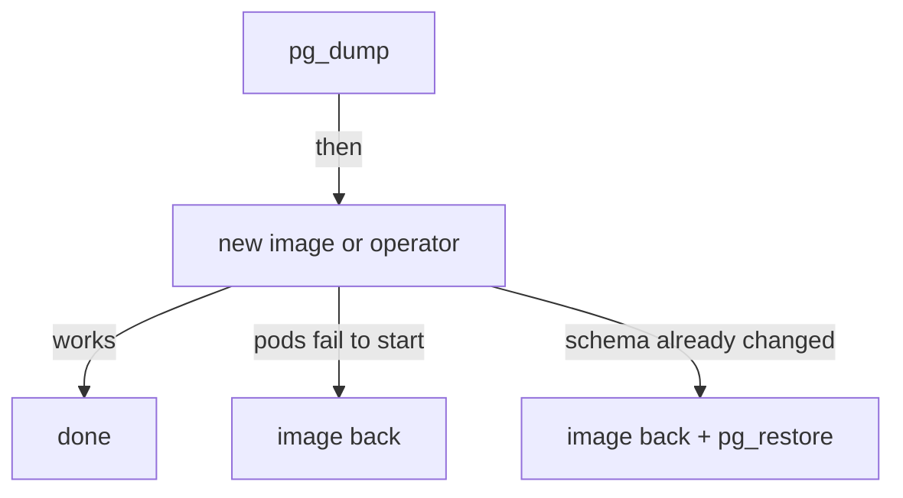

# Upgrading Keycloak With The Operator

A Keycloak upgrade is two things at once: new code in the image, and a change to the database schema that the new code makes the first time it starts. The first is easy to undo; the second is not. This part shows how the Keycloak Operator decides which image to run and how to roll a change out, and it explains why a backup comes before every upgrade.

## Where the image comes from

You never wrote an image into the `Keycloak` resource, yet the pods run `quay.io/keycloak/keycloak:26.8.1`. The operator picks it: each operator release carries a default Keycloak image of the same version, in an environment variable of its own Deployment. Read it:

<!-- astrona:playground:renew -->

```sh
kubectl -n keycloak get deployment keycloak-operator \
  -o jsonpath='{range .spec.template.spec.containers[0].env[*]}{.name}={.value}{"\n"}{end}' | grep -i image
kubectl -n keycloak get statefulset keycloak -o jsonpath='{.spec.template.spec.containers[0].image}{"\n"}'
```

The operator's variable `RELATED_IMAGE_KEYCLOAK` names `quay.io/keycloak/keycloak:26.8.1`, and the StatefulSet runs exactly that image. So the normal way to upgrade Keycloak is to upgrade the operator: the new operator brings a new default image and rolls it out. The field `spec.image` in the `Keycloak` resource overrides the default, for example to run your own image with extra providers built in.

## How the operator rolls out a change

Some changes can roll through the pods one at a time, with the service up all the way. Others need every pod stopped first, because old and new pods cannot run side by side against the same database. The field `spec.update.strategy` decides how the operator chooses:

| Strategy | What the operator does |
| --- | --- |
| `RecreateOnImageChange` (default) | Any change of the image name or tag stops all pods first, then starts the new ones: downtime. Other changes roll pod by pod |
| `Auto` | Runs a Job that compares the old and new configuration, image and version, and rolls pod by pod when they are compatible: same configuration, or a newer patch release of the same `major.minor` line |
| `Explicit` | Rolls pod by pod while `spec.update.revision` stays the same; you change the revision to ask for a full restart |

The `RecreateUpdateUsed` condition reports what the last update did: `Unknown` before any update, `False` after a rolling update, and `True` after a full restart, with the reason in its message.

Switch your playground to `Auto`, then make a small change that the operator can roll pod by pod. Adding a server option is such a change. The patch keeps the two options that are already there:

```sh
kubectl -n keycloak patch keycloak keycloak --type merge -p '{"spec":{
  "update":{"strategy":"Auto"},
  "additionalOptions":[{"name":"health-enabled","value":"true"},{"name":"metrics-enabled","value":"true"},{"name":"log-level","value":"INFO"}]}}'
kubectl -n keycloak get pods -w
```

Watch the pods for a few minutes, then stop the watch with `Ctrl+C`. With `Auto`, the operator first runs a short Job to compare the two versions of the configuration; then it replaces `keycloak-1` and `keycloak-0` one after the other, so one pod always serves. Read the conditions:

```sh
kubectl -n keycloak get keycloak keycloak \
  -o go-template='{{range .status.conditions}}{{.type}}={{.status}} {{.message}}{{"\n"}}{{end}}'
```

`RecreateUpdateUsed` is `False`: the last update rolled pod by pod. If the Job is still running, the condition may not have changed yet; run the command again after a minute.

## Why the backup comes first

A new Keycloak version updates the database schema when it first starts. The old version cannot read the new schema, and Keycloak does not support going back to an older version on a database a newer one has already changed. So if an upgrade goes wrong after the new version started, changing the image back is not enough: you also need the database as it was before the upgrade. The order of a safe upgrade follows from that:



The diagram shows the two ways back: if the new pods never started, putting the old image back is enough; if the new version already changed the schema, the old image needs the old database too.

An image that does not exist at all, for example a mistyped tag, is the simple case: the new pods never start, so nothing touched the database. Under the default `RecreateOnImageChange`, though, the operator stopped every old pod before it found out, so Keycloak is down until you put a working image back. That is one more reason to prefer `Auto` for patch upgrades, and to test the new image tag before you change the resource.

You now know where the Keycloak image comes from, how the three update strategies roll a change out, how to read `RecreateUpdateUsed`, and why every upgrade starts with a database dump. Together with the restore loop, that is everything needed to undo a bad upgrade.

## Common pitfalls

> [!WARNING]
> - **Upgrading without a fresh dump.** After the new version changes the schema, the dump is the only way back.
> - **Changing `spec.image` under the default strategy and expecting no downtime.** `RecreateOnImageChange` stops every pod on an image change.
> - **Setting `spec.image` and forgetting it.** An override stays when you upgrade the operator, so the new default image is never used.
> - **Reading `RecreateUpdateUsed` too early.** Under `Auto`, the decision Job runs first; the condition changes after the rollout.
